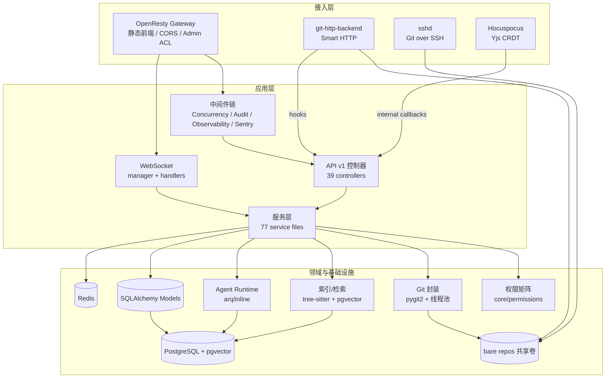
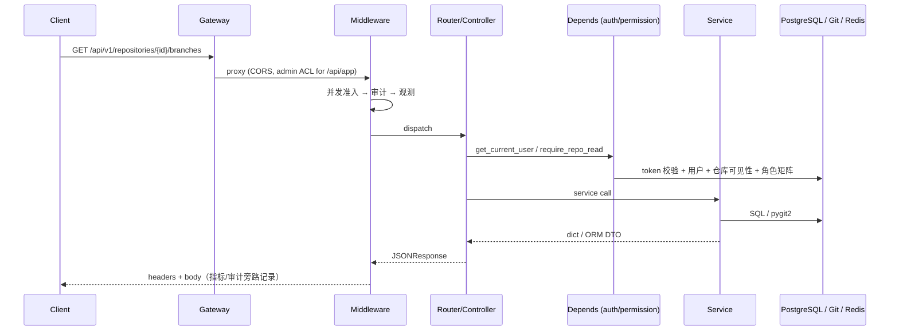
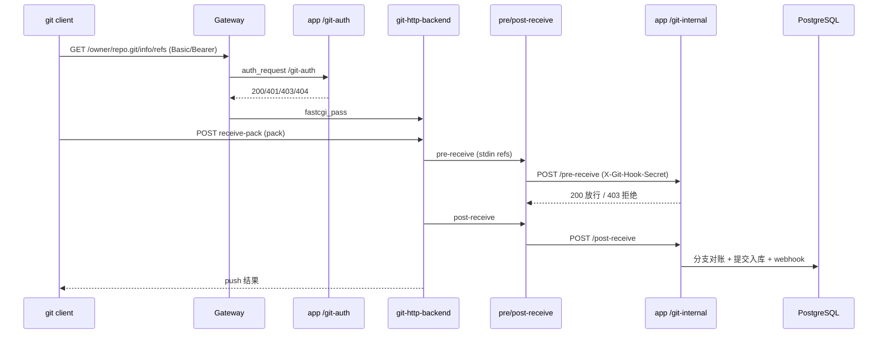
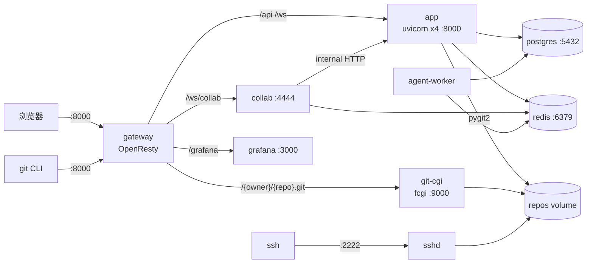

# 02 · 整体架构

> 目标：从「一次请求如何被处理」和「一套服务如何部署」两个视角建立全局图。

---

## 1. 分层架构



### 分层职责

| 层 | 目录 | 职责 | 禁止 |
| --- | --- | --- | --- |
| 接入层 | `docker/`、`collab-gateway/` | 协议、TLS/CORS、静态资源、Git Smart HTTP、SSH、CRDT | 不承载业务规则 |
| 控制器层 | `app/api/v1` | HTTP 参数解析、依赖注入、调用服务、构造响应 | 不直接写 SQL / 不嵌套事务逻辑 |
| 服务层 | `app/services` | 业务规则、事务、权限调用、跨领域编排 | 不解析 HTTP 请求 |
| 领域基础层 | `app/core`、`app/utils`、`app/models` | 配置、权限、异常、Git、日志、ORM | 不反向依赖控制器 |

> 说明：仓库早期存在控制器直连 ORM 的路径（如 `repository_controller` 的简单查询），但复杂业务均下沉到 service；新增代码应遵循 `controller → service → model`。

---

## 2. 应用装配与请求链路

### 2.1 应用创建

`backend/app/main.py:create_app()`：

1. 延迟导入 `lifespan/config/init/logging`（避免导入期污染）。
2. `init_app()`：环境变量检查 → `.env` → 配置加载/校验 → 日志 → 密钥 → 数据库迁移/引导 → 仓库目录。
3. `init_sentry(config)`（DSN 为空时零开销）。
4. 创建 `FastAPI(lifespan=app_lifespan)`。
5. `add_middleware` 顺序：**Concurrency（最内）→ AuditLogger → Observability（最外）**；随后 Sentry ASGI 再包最外层。
6. `app.add_route("/metrics", metrics_response)`。
7. `include_router(api_v1_router)`。
8. `setup_exception_handlers(app)`。

模块底部 `app = get_app()` 使 `uvicorn app.main:app` 可直接工作；`AppCache` 缓存实例以便测试重置。

### 2.2 一次 HTTP 请求



关键点：

- **CORS 只在 Nginx 处理**，应用层不配置 CORS。
- **并发准入**按 `max_concurrent` 信号量 + 可选 Redis 全局计数；上限不超过数据库连接池容量。
- **观测记录范围**由 `middleware/scope.should_record` 单点裁决（排除 `/health`、`/docs`、`/redoc`、`/openapi.json`、`/metrics`）。
- **错误响应**统一为 `{detail, error:{code,message,type,error_code}}`，支持 `Accept-Language` 翻译。

### 2.3 一次 Git push



- pre-receive **fail-closed**：hook 配置缺失、应用不可达、密钥错误都拒绝推送。
- post-receive **永不阻断**，失败靠下次推送自愈。

---

## 3. 部署拓扑



### 服务清单（生产 compose）

| 服务 | 镜像/构建 | 端口 | 卷 | 职责 |
| --- | --- | --- | --- | --- |
| `postgres` | `pgvector/pgvector:pg16` | 5432（内网） | `postgres-data` | 主库 + 向量 |
| `redis` | `redis:7-alpine` | 6379（内网） | 无持久化 | 缓存/pubsub/队列 |
| `app` | `kustos-app`（`backend/Dockerfile`） | `127.0.0.1:8001→8000` | repos/lfs/app-logs | FastAPI 业务 |
| `agent-worker` | 同 app 镜像 | 无 | repos/app-logs | arq Agent 作业 |
| `collab` | `docker/collab/Dockerfile` | 4444/4445（内网） | 无 | Hocuspocus Yjs |
| `git-cgi` | `docker/git-cgi/Dockerfile` | `127.0.0.1:9000` | repos | Git HTTP |
| `sshd` | `docker/ssh/Dockerfile` | `127.0.0.1:2222` | repos | Git over SSH |
| `gateway` | `docker/gateway/Dockerfile` | `${KUSTOS_GATEWAY_PORT:-8000}` | 配置只读 | 统一入口 |
| `docker-socket-proxy` | `tecnativa/docker-socket-proxy` | 内网 | docker.sock ro | 只读容器状态 |
| `docker-write-proxy` | OpenResty | 内网 | docker.sock ro | 仅 start/stop/restart |
| `init`（profile） | app 镜像 | 无 | app-logs | 迁移 + 管理员引导 |
| `test`（profile） | `docker/test/Dockerfile.test` | 无 | 源码挂载 | 容器内 pytest |
| 监控栈（可选） | prometheus/grafana/redis_exporter | 127.0.0.1:9090/3000/9121 | prom/grafana 卷 | 指标与看板 |

### 共享卷与网络

- `repos`：所有 Git 裸仓库，app/git-cgi/sshd/agent-worker 共享。
- `lfs`：本机 LFS 对象。
- `app-logs`：按日期目录的 app/error/audit 日志。
- 网络默认 `kustos-network`（bridge），监控栈复用同名网络。
- 资源限制按服务设置（app 4C/2G，worker 2C/1G，collab 1C/512M 等）。

---

## 4. 关键数据流

### 4.1 代码搜索

```
GET /repositories/{id}/search
  → require_repo_read
  → SearchService.search_code
      ├─ search.enabled? 否 → 空结果 source=none
      ├─ 默认分支 → _ensure_index（懒重建/增量）→ 主库 chunk 查询
      │              └─ embedding_enabled → 语义召回 → RRF 融合
      └─ 其他 ref / 索引不可用 → Git tree 子串扫描 source=git_tree
```

### 4.2 协作编辑保存

```
浏览器 Yjs ↔ collab-gateway (WS)
  onAuthenticate → POST /api/v1/collab/auth（内部密钥 + 用户 token + docKey）
  afterLoadDocument → GET /collab/doc（从 Git 播种）
  stateless collab-save → POST /collab/save（实时权限校验 → Git commit → 更新索引）
  → 广播 collab-saved(commit_id, version)
```

**只有显式保存才落 Git**；`onStoreDocument` 的自动快照只写 Redis 会话快照，避免高频 commit。

### 4.3 Agent 作业

```
POST /repositories/{id}/agent/jobs
  → kill switch / 仓库读权限 / SSRF 白名单 / 配额
  → 落 agent_jobs(queued) + Activity
  → arq 入队（或内联）
worker.process_job
  → CAS queued→running
  → AgentRuntime.run（模型 ↔ 工具循环；每步 checkpoint + WS 推送）
  → ANSWERED / AWAITING_APPROVAL / CANCELLED / BUDGET_EXCEEDED
  → 终态 CAS + 会话摘要 + 频道回帖
```

### 4.4 权限裁决

所有仓库域操作收敛到 `core/permissions.py`（纯策略，无 FastAPI 依赖），
FastAPI 侧的依赖工厂在 `api/guards.py`：

1. 全局 `User.is_admin` 旁路；
2. 公开仓的“参与型”操作（建 issue/PR/评论）登录即放行；
3. 仓库所有者视为 `owner`；
4. 活跃成员的 `role` 命中 `ACTION_MATRIX[action]` 才放行；
5. 历史角色 `viewer` 归一为 `readonly`。

读可见性额外区分：公开仓匿名可读；私仓匿名 401、非成员 403、缺仓 404（先于认证）。

---

## 5. 横切关注点

| 关注点 | 唯一入口 | 说明 |
| --- | --- | --- |
| 配置 | `core/config.py` + `config_schema.py` | 19 个配置节；DB 热轮询 5s；密钥密文表 |
| 权限 | `core/permissions.py` + `api/guards.py` | Action 矩阵在 core（纯策略）；FastAPI 依赖工厂在 api |
| 异常 | `core/exception.py` + `utils/exception_handler.py` | 状态码 + `error_code` + i18n |
| 日志 | `utils/logging.py` | `logs/<date>/{app,error,audit}.log` + WS 实时 |
| 审计 | `middleware/audit_logger.py` + `activities` | 请求审计与业务活动双轨 |
| 指标 | `middleware/observability.py` + `/metrics` | Redis 聚合跨 worker；`scope` 统一口径 |
| 降级 | `utils/degraded.py` | Redis/队列/索引等降级登记，Admin 可见 |
| 多进程一致 | Redis pub/sub + DB 轮询 | 配置版本、WS 广播、presence、撤销位图 |

---

## 6. 关键架构决策

| 决策 | 动机 | 代价/边界 |
| --- | --- | --- |
| bare 仓库 + pygit2 | 无工作树、读写一致、可共享卷 | 同步 IO 必须走线程池；搜索不能扫文件系统 |
| 元数据全落 PG | 事务、外键、复杂查询、审计 | 仓库与 DB 可能短暂不一致（存在性缓存/自愈） |
| 单一权限矩阵 | 消除 40+ 处手写角色列表导致的漏检 | 新 Action 必须登记矩阵 |
| 配置入库 + env 优先 | 后台可改、跨进程热生效 | 引导层键（DB URL/JWT）必须 env；轮询有 5s 延迟 |
| Redis 可选 | 单机/测试可无 Redis 运行 | 多处降级路径需保持语义一致 |
| 协作网关独立进程 | CRDT 是 Node 生态，隔离故障域 | 多一次内部回调与密钥管理 |
| Agent 独立 worker | 长任务不占 Web worker | 需 arq/Redis；无 Redis 时内联 |
| 索引存主库 | 无需外部搜索集群，事务一致 | 大仓库受护栏限制，超限退回 Git 扫描 |

---

## 7. 相关文档

- 启动与配置细节：[03-bootstrap-and-config.md](03-bootstrap-and-config.md)
- API/鉴权/中间件：[04-api-layer.md](04-api-layer.md)
- 部署与网关路由：[11-infrastructure.md](11-infrastructure.md)
- 依赖方向与第三方库：[13-dependencies.md](13-dependencies.md)
