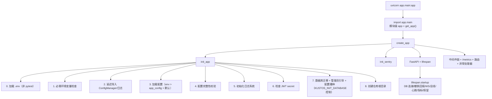
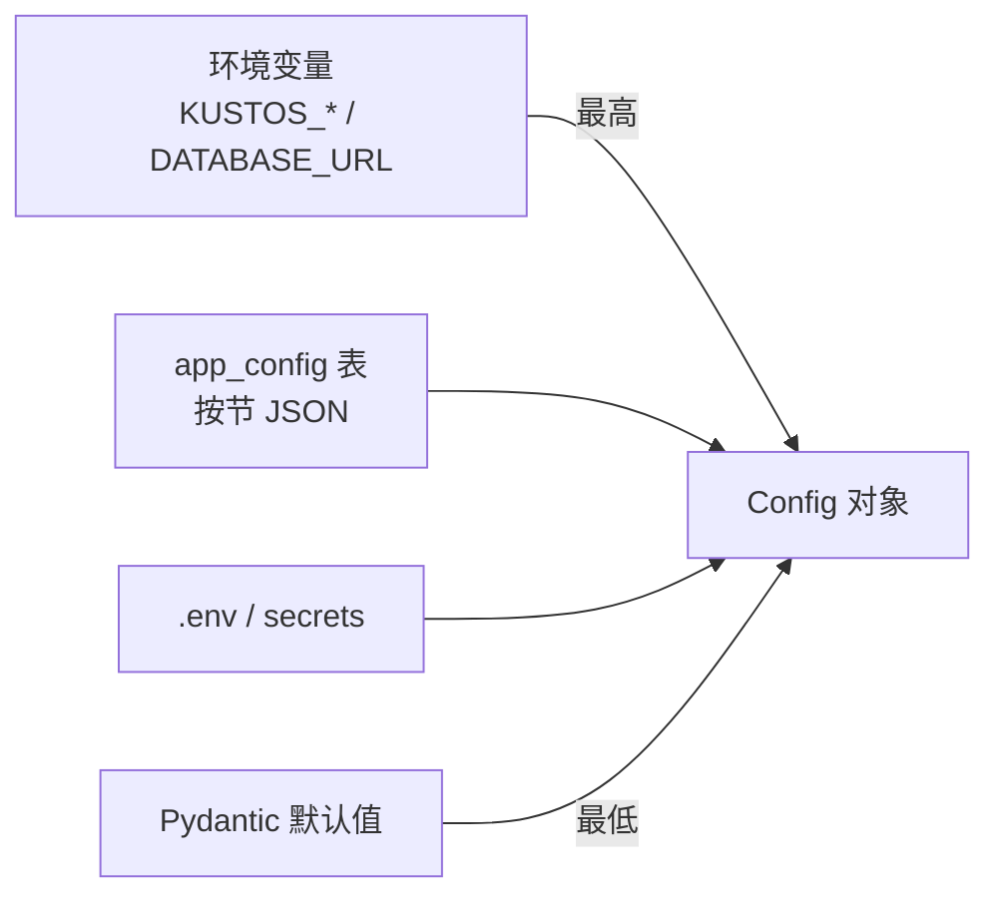

# 03 · 启动流程与配置系统

> 目标：解释应用从进程启动到可服务、以及运行期配置如何读取/修改/热生效。

---

## 1. 启动总览



### 1.1 `create_app()` 的关键顺序

`backend/app/main.py`：

1. **延迟导入**（`lifespan`、`config`、`init`、`logging`）——确保环境变量检查先执行。
2. `init_app()` 失败则抛 `RuntimeError`，阻止不健康启动。
3. Sentry 初始化（无 DSN 直接跳过）。
4. 中间件添加（见 [04-api-layer.md](04-api-layer.md)）。
5. `/metrics` 路由（不走 OpenAPI schema）。
6. 注册 `api_v1_router`。
7. `setup_exception_handlers(app)`（必须在路由之后）。
8. `sentry_middleware(app)` 包最外层。

> `AppCache` 缓存创建结果；`get_app(config_path)` 相同路径复用；`reset()` 供测试清空。

### 1.2 `init_app()` 八阶段

`backend/app/core/init.py:AppInitializer.initialize()`：

| 阶段 | 动作 | 失败策略 |
| --- | --- | --- |
| 0 | `.env` 延迟加载（`override=False`；pytest 跳过） | 无 python-dotenv 时跳过 |
| 1 | 检查必需 env：`KUSTOS_SECURITY_SECRET_KEY`、`DATABASE_URL` | 打印报告并退出 |
| 2 | 延迟导入 `ConfigManager` / 日志 | 失败返回 False |
| 3 | 加载配置（`config_path` 仅兼容；文件已弃用） | 失败返回 False |
| 4 | `validate_config()`：DB/存储/安全/搜索/服务器/日志 | 有 error 则拒绝启动 |
| 5 | `init_logging()`：日期目录、error 分离、WS 推送 | 失败返回 False |
| 6 | 再次确认 secret key 非空 | 失败返回 False |
| 7 | `KUSTOS_INIT_DATABASE=true` → 迁移+管理员；false → 只读就绪校验 | 未就绪拒绝启动 |
| 8 | `ensure_repository_root()` | 失败返回 False |

阶段 7 完成后执行 `config_store.seed_from_example()`：**幂等补缺键**，不覆盖后台已改值；失败仅告警。

### 1.3 数据库初始化

- 迁移：Alembic `backend/alembic/versions/0001_initial.py`（建 **51 张表**并 `CREATE EXTENSION IF NOT EXISTS vector`）→ `0002_pr_issue_review_links.py`（补 `pull_request_issue_links`、`pr_review_requests`），head 共 **53 张表**。
- 独立入口：`python scripts/init_db.py`（`--check-only` 只读校验）。
- 生产 compose：`init` profile 容器执行迁移，`app` 设置 `KUSTOS_INIT_DATABASE=false` 只做只读校验。
- 管理员引导：`DatabaseInitializer.autobootstrap_admin()` 读取 `KUSTOS_ADMIN_USERNAME/PASSWORD/EMAIL`；已存在管理员则跳过。
- 重置：`scripts/reset_admin.py`；调试接口 `DatabaseResetManager`（删表 → 迁移 → 重建管理员）。

### 1.4 生命周期（`lifespan.py`）

**startup（按顺序）**

1. 初始化异步 DB 引擎（失败阻止启动）；
2. `SELECT 1` 验证连接（失败阻止启动）；
3. 回填撤销位图（`RevokedToken` → Redis/内存，失败告警）；
4. 启动 WebSocket 心跳检查任务；
5. 启动跨 worker 实时广播总线（Redis 不可用 → 进程内）；
6. 启动 worker 心跳（Redis 注册表，20s 周期）；
7. 启动进程指标采样（内存/CPU）；
8. 启动自动保留任务（日志目录 + Activity + Agent steps）。

**shutdown（按顺序）**

worker 心跳 → 进程指标 → 保留任务 → 实时总线 → 关闭 WS 连接（先广播 shutdown）→ 有界等待 WebHook 在途投递 → dispose DB 引擎。

**优雅关闭触发**：`trigger_graceful_shutdown()` 优先向进程管理器发 SIGTERM（全部 worker），单进程且 `mark_serving()` 过才自我终止；不再跨事件循环执行 shutdown。

---

## 2. 配置系统

### 2.1 配置来源与优先级



| 优先级 | 来源 | 说明 |
| --- | --- | --- |
| 1（最高） | init kwargs | 测试/显式构造 |
| 2 | 环境变量 | 各节 `env_prefix`（见下表） |
| 3 | `app_config` 表 | 仅 `ConfigManager` 构造期间激活；按节读 JSON |
| 4 | dotenv / secrets | `python-dotenv` 等 |
| 5（最低） | 字段默认值 | `config.py` 中的 `Field(default=...)` |

**引导层键永不出现在库表**：`database.url`、`database.is_stress_test`、`security.secret_key` 只能由 env 注入（防止“拖库即接管”）。

### 2.2 配置节与环境变量前缀

`Config`（`backend/app/core/config.py`）包含 **19 个配置节**；`core/config_schema.py:SECTION_META` 另含无模型的遗留节 `system`（用于保持“整节拒绝”的错误文案）。

| 节 | 环境变量前缀 | 关键字段 | 可写/热生效 |
| --- | --- | --- | --- |
| `server` | 无显式前缀（字段名大写：`HOST`/`PORT`/…） | host/port/reload/log_level | 可写；host/port/log_level 重启生效 |
| `gunicorn` | 无显式前缀 | workers/worker_class/timeout/… | 可写；全部重启生效 |
| `app` | `KUSTOS_APP_` | title/description/version/debug/slow_request_threshold_ms | 不可写；debug 走专用端点 |
| `cors` | 无显式前缀 | allow_origins/methods/headers | 可写；重启生效（实际由 Nginx） |
| `storage` | `KUSTOS_STORAGE_` | repo_root/upload_root/max_repo_size/max_file_size/上传上限 | 可写；路径键保护+重启 |
| `security` | `KUSTOS_SECURITY_` | secret_key/token TTL/算法/撤销 TTL/HSTS | 不可写 |
| `logging` | 无显式前缀 | audit_log_*/log_keep_days/activity_keep_days/retention_interval_hours/agent_steps_keep_days | 不可写 |
| `database` | `KUSTOS_DATABASE_` | url/pool_*/pg_* | 可写（url/is_stress_test 保护） |
| `redis` | `KUSTOS_REDIS_` | url/namespace/pubsub_prefix/reconnect_cooldown | 不可写 |
| `sentry` | `KUSTOS_SENTRY_` | dsn/traces_sample_rate/environment/release | 不可写 |
| `lfs` | `KUSTOS_LFS_` | storage_backend/local_path/s3_*/max_upload_size/transfer_token_ttl_minutes | 不可写 |
| `search` | `KUSTOS_SEARCH_` | enabled/max_results/embedding_*/索引护栏/chunker 护栏 | 可写；热生效 |
| `metrics` | `KUSTOS_METRICS_` | history_minutes/sample_interval_seconds/max_points | 不可写 |
| `oauth` | `KUSTOS_OAUTH_` | github_*/gitlab_* | 不可写 |
| `agent` | `KUSTOS_AGENT_` | enabled/provider/base_url/model/max_steps/配额/worker/trigger | 不可写（专用端点）；worker 参数重启 |
| `realtime` | `KUSTOS_REALTIME_` | WS 心跳/消息上限/presence TTL/chat 长度 | 不可写；热生效 |
| `webhook` | `KUSTOS_WEBHOOK_` | 并发/超时/重试/关闭等待 | 不可写 |
| `collab` | `KUSTOS_COLLAB_` | 邀请默认/最长 TTL | 不可写；热生效 |
| `git` | `KUSTOS_GIT_` | push_max_commits/线程池/存在性缓存 TTL | 不可写 |

**特殊直读环境变量**（不走节前缀）：

- `DATABASE_URL`、`KUSTOS_STRESS_TEST`（`DatabaseSettings` validator）
- `REDIS_URL`（`RedisSettings.url` 为空时回退）
- `KUSTOS_INIT_DATABASE`（初始化模式）
- `KUSTOS_ADMIN_USERNAME/PASSWORD/EMAIL`（管理员引导）
- `KUSTOS_COLLAB_INTERNAL_SECRET`、`KUSTOS_GIT_HOOK_SECRET`
- `KUSTOS_AGENT_API_KEY`（LLM/embedding key，永不入库）
- `KUSTOS_DOCKER_HOST`、`KUSTOS_DOCKER_WRITE_HOST`、`KUSTOS_GRAFANA_*`

### 2.3 `ConfigManager` 单例

```python
ConfigManager(config_path)          # 首次构造时 _load_config()
manager.config                      # 访问时按 TTL 检测 DB 版本
manager.update_config(new_config)   # 先持久化 app_config，后改内存
manager.reload()                    # 强制重读
```

- **DB 版本轮询**：每 `VERSION_CHECK_INTERVAL = 5s` 读 `max(version)`；变化则整份重载，实现跨进程热生效。
- **source 链健康态**：`config_source = "db"` 或 `"degraded"`（库不可读时 env+默认值）。
- **写顺序**：`config_store.update_sections()` 成功后才 `_apply_in_memory()`；失败抛 `ConfigWriteError`，内存不变。
- **乐观锁**：`expected={section: version}` 与写入同事务 CAS；冲突抛 `ConfigVersionConflictError` → 409。
- **死键容错**：`_SectionDbSource` 过滤模型中不存在的键，避免历史残留导致 `extra=forbid` 启动失败。

### 2.4 配置表与密钥

| 表 | 结构 | 说明 |
| --- | --- | --- |
| `app_config` | `section` 唯一 + `payload JSON` + `version` + `updated_by` | 按节一行；写整节覆盖；version 用于 CAS/轮询 |
| `config_secrets` | `(section,name)` 唯一 + `ciphertext` | AES-256-GCM 密文 `enc:v1:...`；AAD 绑定节/字段名 |

- 密钥读路径：`config_store.get_secret(section, name)`，进程内 5s TTL 缓存；解密失败抛 `ConfigSecretError`，由调用方降级。
- 配置表播种来源：`config.example.toml`（`example_seed_data()`）。
- 敏感字段脱敏：`ConfigService._mask_sensitive()` 将 `secret_key/api_key/password/token/dsn` 等整值替换为 `***`；`database.url` 仅掩凭据段。

### 2.5 配置管理 API

| 端点 | 权限 | 说明 |
| --- | --- | --- |
| `GET /api/app/config` | debug 或 admin | 返回脱敏配置 + 来源元数据 |
| `POST /api/app/config` | debug 或 admin | 通用写入，按 `SECTION_META` 逐节/逐键校验 |
| `POST /api/app/config/reset` | 危险权限 | 用模板重置 `app_config` |
| `POST /api/app/config/validate` | 危险权限 | 预校验，不写入 |
| `POST /api/app/debug` | 危险权限 | 切换 debug 模式 |

**可写规则（`config_schema.py`）**：

- `writable=False` 的节整节拒绝；
- `writable=True` 中 `protected_keys`（如 `storage.repo_root`）、`bootstrap_excluded_keys`（如 `database.url`）逐键拒绝；
- `restart_keys` 命中的键返回“重启生效”提示；
- `hot=True` 的节在 TTL 轮询后生效。

---

## 3. 配置完整性校验

`validate_config()` 返回 `ConfigValidationResult`（errors/warnings）：

| 检查 | 规则 |
| --- | --- |
| 数据库 | 仅 PostgreSQL；pool_size≥1、overflow≥0、timeout≥1、recycle≥0；SSL 模式合法；并发上限不超过连接池容量（超出给 warning 并收窄） |
| 存储 | `repo_root` 可创建/可写；`max_file_size > max_repo_size` 警告；LFS local 路径可创建 |
| 安全 | 生产必须 `KUSTOS_SECURITY_SECRET_KEY`；token TTL 合理性；JWT 算法白名单 |
| 搜索 | `embedding_enabled` 时 `embedding_dim` 必须等于 `VECTOR_DIM`（否则 warning） |
| 服务器 | <1024 端口提示特权端口 |
| 日志 | 审计日志目录可创建 |

--- 

## 4. 日志与审计

### 4.1 日志布局

```
logs/
└── 2026-10-27/
    ├── app.log      # DEBUG/INFO（含简化信息）
    ├── error.log    # WARNING+（含堆栈，4xx 降为单行 warning）
    └── audit.log    # 审计（请求级；可关闭）
```

- `LogManager` 使用 `RotatingFileHandler`（默认 10MB × 5），日期目录可自动清理。
- 所有 logger 继承根处理器，`WebSocketLogHandler` 将日志推送到 `/ws/logs`（仅管理员）。
- `init_logging` 在 `init_app` 阶段 5 调用；参数包含 `use_date_directory=True`、`separate_error_log=True`、`websocket_output=True`。

### 4.2 审计双轨

| 轨道 | 写入点 | 数据 |
| --- | --- | --- |
| 请求审计 | `middleware/audit_logger.py` → `logs/<date>/audit.log` | request_id、IP、method/path、UA、用户、状态码、耗时、敏感操作 |
| 业务活动 | `activity_service.record_activity` → `activities` 表 | 实体类型/ID、动作、操作者、仓库、details；用于 UI 动态流与审计查询 |

`audit_log_enabled=false` 时中间件与文件全部短路。请求体/响应体默认不记录（可配置开启，敏感字段过滤）。

---

## 5. 启动常见失败与定位

| 现象 | 可能原因 | 处理 |
| --- | --- | --- |
| `KUSTOS_SECURITY_SECRET_KEY 未设置` | 生产未注入密钥 | 设置 env / 运行 `scripts/generate_env.py --prod` |
| `数据库 schema 未就绪，拒绝启动` | `KUSTOS_INIT_DATABASE=false` 且未跑 init | `docker compose --profile init run --rm init` |
| `配置完整性校验失败` | repo_root 不可写 / secret 为空 / 维度不匹配 | 查看启动报告中的 errors |
| `创建异步数据库引擎失败` | DATABASE_URL 错误/驱动缺失 | 校验 URL 与 `asyncpg` 安装 |
| `Redis 不可用` 告警但服务可用 | 可选依赖缺失 | 可接受；相关功能降级 |
| `配置文件 config.toml 已弃用` | 残留旧文件 | 删除或忽略，不生效 |

---

## 6. 相关源码

- `backend/app/main.py`
- `backend/app/core/init.py`
- `backend/app/core/config.py`
- `backend/app/core/config_schema.py`
- `backend/app/lifespan.py`
- `backend/app/core/init.py`（`AppInitializer`）
- `backend/app/core/config_store.py`
- `backend/app/services/platform/config_service.py`
- `backend/app/utils/init_database.py`、`db_migrate.py`
- `backend/app/utils/logging.py`
- `backend/alembic/versions/0001_initial.py`
