# 05 · 数据模型

> 目标：给出 51 张表的领域分组、关键字段、约束与关系，作为代码阅读和二次开发的索引。

---

## 1. 基础约定

### 1.1 主键与时间戳

所有业务表继承 `models/base.py:TimestampMixin`（别名 `BaseModel`）：

| 列 | 类型 | 说明 |
| --- | --- | --- |
| `id` | UUID | 默认 `generate_uuid7()`，时间有序，主键 + 索引 |
| `created_at` | `timestamptz` | `server_default=now()` |
| `updated_at` | `timestamptz` | `server_default=now()`，`onupdate=now()` |

> UUIDv7 让 B-tree 插入保持局部性，同时保留时间排序能力；Agent 僵尸回收、增量索引等都以 `updated_at` 为判据。

### 1.2 数据库

- **仅 PostgreSQL**（`core/db_url.py` 校验），迁移启用 `vector` 扩展。
- 同步引擎 `psycopg2`（`models/__init__.py`），异步引擎 `asyncpg`（`models/async_db.py`）。
- 连接池参数按 `database.is_stress_test` 在普通/压力两套配置间切换。
- 外键策略混合：多数为默认 `NO ACTION`；聊天/文件评论/协作覆盖等使用 `CASCADE`；撤销记录用户删除时 `SET NULL`。

### 1.3 关系总览

```mermaid
erDiagram
    users ||--o{ repositories : owns
    users ||--o{ repository_members : joins
    repositories ||--o{ repository_members : has
    repositories ||--o{ branches : has
    repositories ||--o{ commits : stores
    branches ||--o{ commits : points
    repositories ||--o{ pull_requests : has
    pull_requests ||--o{ pr_comments : has
    pull_requests ||--o{ pr_reviews : has
    pull_requests ||--o{ pr_review_requests : requests
    pull_requests ||--o{ pull_request_issue_links : links
    issues ||--o{ pull_request_issue_links : linked_by
    repositories ||--o{ issues : has
    issues ||--o{ issue_comments : has
    issues }o--o{ labels : tags
    repositories ||--o{ releases : has
    releases ||--o{ release_assets : has
    repositories ||--o{ webhooks : has
    webhooks ||--o{ webhook_deliveries : logs
    repositories ||--o| realtime_rooms : channel
    realtime_rooms ||--o{ room_members : has
    realtime_rooms ||--o{ chat_messages : contains
    realtime_rooms ||--o| direct_messages : dm_pair
    repositories ||--o{ file_comments : has
    repositories ||--o{ repo_search_chunks : indexed
    repositories ||--o{ repo_search_refs : indexed
    repositories ||--o{ repo_search_embeddings : embedded
    repositories ||--o| repo_search_state : state
    repositories ||--o{ repo_commit_files : changed
    repositories ||--o| repo_commit_index_state : state
    users ||--o{ agent_sessions : owns
    agent_sessions ||--o{ agent_jobs : contains
    agent_jobs ||--o{ agent_steps : steps
    repositories ||--o{ agent_jobs : targets
    agent_triggers ||--o{ agent_trigger_runs : runs
    users ||--o{ notifications : receives
    users ||--o{ ssh_keys : has
    users ||--o{ user_oauth_accounts : binds
    repositories ||--o{ stargazers : starred
    repositories ||--o{ watchers : watched
    repositories ||--o{ activities : audit
    repositories ||--o{ pr_activities : audit
```

---

## 2. 表目录（按领域）

### 2.1 身份与访问（6）

| 表 | ORM | 关键字段 | 约束/索引 | 说明 |
| --- | --- | --- | --- | --- |
| `users` | `User` | username, email, password, full_name, avatar_url, is_active, is_admin, is_bot | username/email 唯一索引 | `is_bot=true` 的 Agent 用户不可登录 |
| `ssh_keys` | `SSHKey` | user_id, name, public_key, fingerprint | fingerprint 索引 | Git over SSH 公钥 |
| `user_oauth_accounts` | `UserOAuthAccount` | user_id, provider, provider_user_id, provider_username, access/refresh_token, token_expires_at | `(provider, provider_user_id)` 唯一 | GitHub/GitLab 绑定 |
| `revoked_tokens` | `RevokedToken` | jti, user_id, token_type, expires_at | jti 唯一；expires_at 索引 | 审计 + 启动回填源（热路径走 Redis 位图） |
| `app_config` | `AppConfig` | section, payload(JSON), version, updated_by | section 唯一 | 按节运行期配置 |
| `config_secrets` | `ConfigSecret` | section, name, ciphertext | `(section,name)` 唯一 | AES-GCM 密文密钥（LLM/embedding） |

### 2.2 仓库与 Git（7）

| 表 | ORM | 关键字段 | 约束/索引 | 说明 |
| --- | --- | --- | --- | --- |
| `repositories` | `Repository` | name, path(唯一), description, is_public, owner_id, default_branch, forked_from_id, fork/star/watch_count, is_archived, ci_secret | path 唯一；owner 自关联 | 逻辑仓库；物理 bare 仓库另行存储 |
| `repository_members` | `RepositoryMember` | repository_id, user_id, role, is_active | — | 角色 owner/admin/developer/readonly |
| `branches` | `Branch` | name, repository_id, commit_hash, is_protected, require_code_review, require_status_checks, is_default | — | DB 分支 + 保护策略；tip 由 push 对账 |
| `commits` | `Commit` | hash, repository_id, branch_id, author/committer、message、parent_hashes | `(repository_id, hash)` 唯一 | 跨仓共享提交各仓各存；分支删除保留行 |
| `build_status` | `BuildStatus` | repo_id, branch, commit_sha, status, triggered_by, started/finished_at, details_url, logs, failure_summary | status 索引 | CI/构建状态；无 FK（防构建历史拖累删除） |
| `build_log_entries` | `BuildLogEntry` | build_id, seq, line | `(build_id, seq)` 唯一 | 结构化日志行 |
| `repo_commit_files` | `RepoCommitFile` | repository_id, commit_sha, path, status, additions, deletions, changed_ranges | 复合索引 repo+commit / repo+path | 变更图索引：每提交每文件改动 |

### 2.3 协作流程：PR / Issue / 评论 / 标签（14）

| 表 | ORM | 关键字段 | 约束/索引 | 说明 |
| --- | --- | --- | --- | --- |
| `pull_requests` | `PullRequest` | repository_id, pr_number, title, description, source/target_branch, author_id, status, is_draft, merged_by, merged_commit_hash | `(repo, pr_number)` 唯一 | open/merged/closed |
| `pr_comments` | `PRComment` | pull_request_id, author_id, content, file_path, line_number, commit_hash, parent_id | — | 支持行级与回复 |
| `pr_reviews` | `PRReview` | pull_request_id, reviewer_id, status, comment | — | 已提交的评审结论：pending/approved/changes_requested |
| `pr_review_requests` | `PRReviewRequest` | pull_request_id, reviewer_id, requested_by | `(pr, reviewer)` 唯一 | 评审请求；state 由 `pr_reviews` 推导，未提交即 pending |
| `pull_request_issue_links` | `PullRequestIssueLink` | pull_request_id, issue_id, created_by, closes_on_merge | `(pr, issue)` 唯一 | PR ↔ Issue 关联；`closes_on_merge` 决定合并是否关单 |
| `pr_activities` | `PRActivity` | pull_request_id, actor_id, action, details | — | PR 活动流（含 merge_override 审计） |
| `pr_label_definitions` | `PRLabel` | repository_id, name, color, description | — | 仓库级 PR 标签定义 |
| `pr_labels` | 关联表 | pull_request_id, pr_label_id | — | PR ↔ 标签 |
| `issues` | `Issue` | repository_id, issue_number, title, description, author_id, status, priority, assignee_id, closed_by | `(repo, issue_number)` 唯一 | open/closed |
| `issue_comments` | `IssueComment` | issue_id, author_id, content | — | — |
| `labels` | `Label` | repository_id, name, color, description | — | Issue 标签 |
| `issue_labels` | 关联表 | issue_id, label_id | — | Issue ↔ 标签 |
| `repo_label_definitions` | `RepoLabel` | repository_id, name, color, description | — | 仓库标签定义 |
| `repo_labels` | 关联表 | repository_id, repo_label_id | — | 仓库 ↔ 标签 |

### 2.4 Release / Webhook / 文件评论（5）

| 表 | ORM | 关键字段 | 约束/索引 | 说明 |
| --- | --- | --- | --- | --- |
| `releases` | `Release` | repository_id, release_number, tag_name, name, description, author_id, commit_hash, is_draft, is_prerelease | `(repo, release_number)` 唯一 | 版本发布 |
| `release_assets` | `ReleaseAsset` | release_id, name, file_path, file_size, content_type, download_count | — | 发行附件 |
| `webhooks` | `WebHook` | repository_id, url, events(JSON 文本), secret, is_active, content_type, last_* | — | 事件订阅；`events` 由方法读写 JSON |
| `webhook_deliveries` | `WebHookDelivery` | webhook_id, event, payload, request_headers, response_*, duration_ms, is_success, error_message | — | 投递历史 |
| `file_comments` | `FileComment` | repository_id, author_id, content, file_path, line_number, branch, commit_hash, parent_id, resolved | line_number≥1 检查；repo+file+created 索引 | 不依赖 PR 的行内评论 |

### 2.5 实时通信（4）

| 表 | ORM | 关键字段 | 约束/索引 | 说明 |
| --- | --- | --- | --- | --- |
| `realtime_rooms` | `RealtimeRoom` | repository_id(唯一,可空), name, topic, is_active, room_type | repository_id 唯一 | 仓库频道或 DM 房间 |
| `room_members` | `RoomMember` | room_id, user_id, role, joined_at, last_read_at, is_muted | `(room_id,user_id)` 唯一 | 未读/静音 |
| `chat_messages` | `ChatMessage` | room_id, sender_id, message_type, content, reply_to_id, edited_at, metadata | room+created 索引 | 聊天消息（WS/REST 共用） |
| `direct_messages` | `DirectMessage` | room_id(唯一), user_a_id, user_b_id | `(user_a,user_b)` 唯一 | 用户对规范排序，保证唯一 DM |

### 2.6 搜索与索引（5）

| 表 | ORM | 关键字段 | 约束/索引 | 说明 |
| --- | --- | --- | --- | --- |
| `repo_search_state` | `RepoSearchState` | repository_id(唯一), indexed_commit, index_generation | repository_id 唯一 | 索引已覆盖提交 + 代次（自愈） |
| `repo_search_chunks` | `RepoSearchChunk` | repository_id, path, chunk_index, symbol, kind, start_line, end_line, content, size | `(repo,path,chunk_index)` 唯一；`(repo,symbol)` B-tree | 块级全文索引（迁移未建 pg_trgm GIN） |
| `repo_search_refs` | `RepoSearchRef` | repository_id, path, name, line | `(repo,path,name,line)` 唯一；`(repo,name)` 索引 | 标识符引用边 |
| `repo_search_embeddings` | `RepoSearchEmbedding` | repository_id, path, chunk_index, model, dim, vector | `(repo,path,chunk_index,model)` 唯一 | pgvector `vector(1536)` |
| `repo_commit_index_state` | `RepoCommitIndexState` | repository_id(唯一), indexed_commit, index_generation | repository_id 唯一 | 变更图索引状态 |
| （`repo_commit_files` 见 Git 组） | — | — | — | — |

### 2.7 Agent（5）

| 表 | ORM | 关键字段 | 约束/索引 | 说明 |
| --- | --- | --- | --- | --- |
| `agent_sessions` | `AgentSession` | user_id, repository_id, title, summary, summary_updated_at | user/repo 索引 | 会话 + 跨作业确定性摘要 |
| `agent_jobs` | `AgentJob` | session_id, repository_id, source_room_id, user_id, status, origin, prompt, result, error, provider, model, step_count, tokens_used/prompt/completion/cached, pending_approval, approval_decision/reason, runtime_state | status 索引 | 状态机核心 |
| `agent_steps` | `AgentStep` | job_id, seq, type, name, content, data | `(job_id,seq)` 唯一 | checkpoint + 流式事件 |
| `agent_triggers` | `AgentTrigger` | repository_id, event_type, enabled, target_room_id, prompt_template, min_interval_seconds, last_fired_at, created_by | repo/event 索引 | push / build_failed / schedule |
| `agent_trigger_runs` | `AgentTriggerRun` | trigger_id, dedup_key, job_id | `(trigger_id,dedup_key)` 唯一 | 去重 + 审计 |

### 2.8 通知 / 社交 / 审计（5）

| 表 | ORM | 关键字段 | 约束/索引 | 说明 |
| --- | --- | --- | --- | --- |
| `notifications` | `Notification` | user_id, type, title, message, repository_id, target_type/id, is_read, read_at | `(user_id,is_read)`、created_at 索引 | 站内通知 |
| `notification_preferences` | `NotificationPreference` | user_id(唯一), 各类型邮件开关 | user_id 唯一 | 邮件偏好 |
| `stargazers` | `Stargazer` | repository_id, user_id | — | Star 关联 |
| `watchers` | `Watcher` | repository_id, user_id | — | Watch 关联 |
| `activities` | `Activity` | repository_id, actor_id, entity_type, entity_id, action, details | — | 业务活动流/审计 |

### 2.9 协作编辑与邀请（2）

| 表 | ORM | 关键字段 | 约束/索引 | 说明 |
| --- | --- | --- | --- | --- |
| `collab_session_overrides` | `CollabSessionOverride` | doc_key, user_id, scope(read/write/NULL), is_kicked, created_by | `(doc_key,user_id)` 唯一；scope CHECK | 会话级权限覆盖/踢人 |
| `collab_invite_revocations` | `CollabInviteRevocation` | jti, doc_key, expires_at | jti 唯一 | 邀请链接撤销审计/回填 |

> 共 51 张表：身份 6 + 仓库/Git 7 + PR/Issue/标签 12 + Release/Webhook/评论 5 + 实时 4 + 搜索 5 + Agent 5 + 通知/社交/审计 5 + 协作编辑 2 = 51。

---

## 3. 关键不变量

| 不变量 | 实现 |
| --- | --- |
| 用户唯一 | `users.username` / `users.email` 唯一索引 |
| 仓库路径唯一 | `repositories.path` 唯一；物理路径由其派生 |
| PR/Issue/Release 编号仓库内唯一 | 复合唯一约束 `(repository_id, number)` |
| 提交按仓库唯一 | `(repository_id, hash)`；跨仓 fork 各存一行 |
| 聊天房间与仓库一对一 | `realtime_rooms.repository_id` 唯一（可空用于 DM） |
| DM 用户对唯一 | `(user_a_id,user_b_id)` 规范化排序后唯一 |
| 索引块身份唯一 | `(repository_id, path, chunk_index)` |
| Agent 步骤序号唯一 | `(job_id, seq)` |
| 配置节唯一 | `app_config.section` 唯一 |
| 密钥字段唯一 | `config_secrets(section,name)` 唯一 |

---

## 4. 迁移与演进

- 初始迁移：`backend/alembic/versions/0001_initial.py`（51 张表 + 索引 + `vector` 扩展）。
- 运行机制：`scripts/init_db.py` / `init_app` 调用 `alembic upgrade head`；生产 app 只做 `verify_database_ready()` 只读校验。
- 迁移即 schema 的唯一真相：`tests/test_schema_drift.py` 断言 ORM metadata 与迁移 schema 一致；`test_index_debt.py` 检查索引缺口。
- 索引代次：`repo_search_state.index_generation` / `repo_commit_index_state.index_generation` 用于“旧代索引残留”自愈，代次不符触发全量重建。
- 删除仓库顺序：物理仓 → 搜索索引 → 房间/成员 → 仓库行（避免外键阻塞）。

---

## 5. 数据一致性注意点

1. **Git 与 DB 双真相**：物理仓库与 `repositories`/`branches`/`commits` 可能短暂不一致；`sync_repository_default_branch` 与 post-receive 对账自愈。
2. **分支删除保留提交**：`commits.branch_id` 可空；分支重建后由后续推送重新挂靠。
3. **存在性缓存**：`repository_service` 用进程内 + Redis 缓存物理仓存在状态（默认 TTL 30s），创建/删除时主动失效。
4. **配置引导键不落库**：`database.url`、`security.secret_key` 永不出现在 `app_config`，避免拖库接管。
5. **Agent 密钥不落库**：Bearer key 只在内存/环境变量；`config_secrets` 只存加密后的管理员录入密钥。
6. **撤销热路径不查表**：`revoked_tokens` 仅审计与回填，实时判断走 `token_state` 位图。

---

## 6. 相关源码

- `backend/app/models/`（全部 ORM）
- `backend/app/models/base.py`、`uuid7.py`、`async_db.py`
- `backend/alembic/versions/0001_initial.py`
- `backend/tests/test_schema_drift.py`、`test_commit_schema.py`、`test_index_debt.py`
