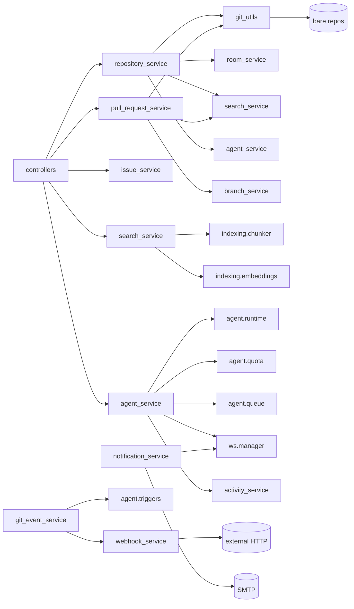

# 06 · 服务层

> 目标：按领域梳理服务文件的职责、关键函数与依赖，作为“改需求时该动哪里”的地图。

---

## 0. 目录组织

服务层按**领域**分包，与前端 `src/features/` 的切分口径一致：

| 包 | 领域 | 覆盖 |
| --- | --- | --- |
| `services/repository/` | 仓库与 Git 对象 | 仓库本体、浏览器、分支、提交、成员、密钥、fork/star/watch、语言统计、活动审计 |
| `services/collaboration/` | 协作内容 | Issue、Pull Request（评审/标签/关联/活动子域）、标签、行内评论、Release、协作邀请、统计看板 |
| `services/messaging/` | 消息 | 站内通知、通知偏好、聊天附件 |
| `services/lfs/` | Git LFS | 业务逻辑、存储后端、短时效 transfer token |
| `services/search/` | 搜索 | 代码检索主服务、搜索/embedding 管理面 |
| `services/integration/` | 外部集成 | Git hooks 回调、Webhook 投递与签名、CI 构建记录 |
| `services/platform/` | 平台运维 | 应用控制、配置管理、数据库重置、指标与监控栈、容器编排、保留策略、worker 注册表 |
| `services/agent/` | 内置 Agent | 会话编排、工具执行、provider 适配、配额 |
| `services/auth/` | 认证与用户 | 令牌生命周期、撤销位图、OAuth 适配器、用户账号 |
| `services/indexing/` | 索引 | 源码切块、embedding provider |
| `services/realtime/` | 实时 | 事件总线、presence、房间、聊天、WS 出站推送 |

约定与命名规范见 `backend/app/services/README.md`。子包 `__init__` 保持轻量
（不 re-export），跨领域调用写全路径——让依赖方向在 import 语句里看得见。

---

## 1. 服务层设计规则

| 规则 | 说明 |
| --- | --- |
| 控制器不写业务 | controller 负责参数/依赖/响应；业务规则在 service |
| 服务不读 HTTP | 不依赖 `Request`/`Response`；错误用 `core.exception` 业务异常 |
| 权限在服务内复核 | 控制器有依赖守卫，服务对敏感操作仍调用 `has_repo_action/ensure_repo_action`（防内部调用绕过） |
| 事务边界 | 一般由 FastAPI 依赖 `get_async_db` 提交/回滚；需要隔离的步骤用 `get_async_db_context()` 独立短会话（Agent 步骤、WebHook 投递） |
| 阻塞 IO 走线程 | pygit2/文件/同步 DB 一律 `asyncio.to_thread` 或专用线程池（`utils/git_utils._git_executor`） |
| 失败降级 | 外部依赖失败不得把主流程打崩；降级登记到 `utils.degraded` |

### 服务形态

- **模块级函数**：仓库/分支/PR/Issue 等（无状态，直接传 `db`）。
- **类 + 单例**：`SearchService`、`AgentService`、`ConfigService`、`AppService`、`MonitoringService`、`ProcessMetrics`、`RetentionService` 等。
- **工厂**：`get_app_service()`、`get_config_service()`、`get_monitoring_service()`、`get_docker_control_service()`。
- **Protocol/注册表**：Agent `ModelProvider`、`JobQueue`、`ToolSpec`、EmbeddingProvider。

---

## 2. 仓库与 Git 域

| 服务 | 职责 | 关键函数/类 | 依赖 |
| --- | --- | --- | --- |
| `repository_service` | 仓库 CRUD、可见性、物理存在性缓存、默认分支同步、可访问仓库集合 | `create_repository`（DB + 初始化 bare 仓 + 默认分支 + owner 成员 + 仓库频道 + bot 入驻）、`delete_repository`（物理删除 + 索引清理 + 房间清理）、`get_accessible_repository_ids`、`sync_repository_default_branch`、`_check_physical_repo_exists_async` | `git_utils`、`room_service`、`search_service`、`agent_service` |
| `repository_browser_service` | 纯读代码浏览 + Web 端文件写入 | `get_tree_entries`、`get_blob_content`、`get_commits`、`get_diff`、`get_blame`、`get_commit_graph`、`compare`、`get_readme_content`、`get_file_symbols`、`commit_file`、`remove_file`、`move_file` | `pygit2`（`offload_to_thread`）、`git_utils` |
| `branch_service` | 分支 CRUD、保护设置、ref 物化 | `create_branch`（先落 Git ref 再写 DB，防孤儿）、`update_branch`（受保护字段白名单）、`delete_branch`、`check_branch_protection` | `git_utils` |
| `commit_service` | 提交列表/详情/文件统计 | 查询 `Commit` + Git 对象补全 | `pygit2` |
| `commit_index_service` | 变更图索引（提交 × 文件 × 改动区间） | `rebuild_index`、`update_for_push`、`ensure_index`；代次自愈 | `pygit2`、`repo_commit_files` |
| `fork_service` | Fork 仓库（复制 bare 仓 + DB 关系 + 计数） | `fork_repository`、`list_forks` | `git_utils` |
| `star_service` / `watch_service` | Star/Watch 计数与关联 | `star`/`unstar`、`watch`/`unwatch`、计数同步 | `stargazers`/`watchers` |
| `git_event_service` | pre/post-receive 回调业务 | `evaluate_pre_receive`（保护分支禁删/禁强推 + 单文件上限）、`handle_post_receive`（分支对账、提交入库、push/tag_push webhook、触发器派发） | `pygit2`、`webhook_service`、`agent.triggers` |
| `lfs_service` / `lfs_storage` / `lfs_token` | LFS batch 与对象存取 | `LFSService`、`LocalFSStorage(repo_id)`、`create/verify_lfs_transfer_token` | 文件系统、JWT |
| `language_service` | 文件名 → 语言映射/统计 | `detect_file_language` 等 | 无 |

---

## 3. 协作内容域（PR / Issue / Release / 评论）

| 服务 | 职责 | 关键函数 | 说明 |
| --- | --- | --- | --- |
| `pull_request_service` | PR 全生命周期 | `create_pull_request`、`publish_draft`、`update_pull_request`、`close_pull_request`、`merge_pull_request`、`enforce_merge_protection`、`has_effective_approval`、`evaluate_status_checks`、`get_pr_diff`、`get_pr_file_diff`、`create_pr_comment`、`create_pr_review` | 合并方式 merge/squash/rebase；自我 approve 不计；admin bypass 写审计 |
| `pr_issue_link_service` | PR ↔ Issue 关联 | `link_issue_to_pr`/`unlink_issue_from_pr`、`auto_link_from_description`、`close_linked_issues` | 只认同仓库；`Fixes #N` 自动建边；合并按 `closes_on_merge` 关单 |
| `pr_review_request_service` | 评审请求（requested reviewer） | `request_reviewers`、`remove_reviewer`、`list_review_requests` | 评审人是仓库成员；state 由 `pr_reviews` 推导；请求后发通知 |
| `pr_activity_service` | PR 活动流 | `record_pr_activity`、列表查询 | 与 Activity 表分离 |
| `pr_label_service` | PR 标签定义/绑定 | CRUD + 批量绑定 | 仓库级定义 |
| `issue_service` | Issue 全生命周期 | 列表（状态/标签/指派/作者过滤）、创建、更新、关闭/重开、批量操作、评论 | 编号仓库内自增 |
| `label_service` | Issue 标签 CRUD | 创建/更新/删除/列表 | 颜色校验 |
| `file_comment_service` | 行内评论（文件/行/分支/提交锚定） | 创建、回复、解决、列表 | 作者或 admin 可改/删 |
| `release_service` | Release 生命周期 | 创建/更新/发布/删除、与 tag 关联 | 草稿/预发布 |
| `release_asset_service` | 发行附件上传/下载/删除 | 存储路径、大小限制、下载计数 | `storage.upload_root` 子目录 |
| `build_service` | 构建状态 | `create_build`、`ensure_build_for_commit`（去重）、日志写入、失败摘要 | CI 回调 |
| `dashboard_service` | 用户仪表盘聚合 | 我的仓库/PR/Review/构建/贡献者 | 多表聚合 |
| `stats_service` | 仓库/平台统计 | PR/Issue/Review/Star/成员计数 | — |
| `activity_service` | 业务活动流 | `record_activity`、`try_record_activity`（吞异常）、`list_activities` | Agent 决策/写工具审计 |
| `member_service` | 仓库成员/角色 | 列表、添加、更新角色、移除、转移所有权 | 与权限矩阵配合 |
| `attachment_service` | 聊天附件 | 上传（大小/文件名校验）、读取 | `storage.upload_root/attachments` |
| `key_service` | SSH Key | 列表/添加（解析 fingerprint）/删除 | — |

---

## 4. 认证、用户与安全

| 服务 | 职责 | 关键函数 |
| --- | --- | --- |
| `user_service` | 注册/登录/资料/密码/头像/管理员用户管理 | `login_user`、`register_user`、`update_profile`、`change_password` |
| `token_service` | JWT 签发/校验/刷新轮换/撤销 | `create_token_pair`、`verify_token`、`verify_token_active`、`refresh_access_token`、`revoke_token`、`revoke_family`、`backfill_revocations` |
| `token_state` | 撤销位图（Redis 单层 + 内存回退） | `revoke`、`is_revoked`、`backfill` |
| `revocation_cache` | 撤销正/负缓存 | TTL 正 3600s / 负 60s |
| `oauth_service` + `auth/oauth.py` | GitHub/GitLab OAuth | `GitHubProvider`、`GitLabProvider`、state 临时存储、绑定/解绑 |
| `audit_query_service` | 审计查询（文件 + activities 表） | `query_audit`、`parse_audit_line` |
| `security_utils`（utils） | 敏感字段过滤、密码哈希 | `filter_sensitive_data`、`get/verify_password_hash` |

---

## 5. 实时与聊天

| 服务 | 职责 | 关键函数 |
| --- | --- | --- |
| `realtime/room_service` | 房间 CRUD、成员、静音、未读、bot 入驻 | `create_room`、`get_repository_room`、`add_member`、`ensure_bot_member`、`add_bot_to_repository_rooms` |
| `realtime/chat_service` | 消息发送/列表/搜索/编辑/删除/反应；@bot 桥接收口 | `send_message`（校验成员→落库→广播→`maybe_enqueue_from_mention`）、`list_messages`、`search_messages` |
| `realtime/event_service` | 通用事件广播 | `broadcast_event` → `send_to_room` |
| `realtime/presence_service` | 在线状态（Redis 引用计数） | `add`、`remove`、`list_users`、`refresh`；Redis 缺失降级本进程 |
| `agent/chat_bridge` | @kustos-agent → Agent 作业 | `maybe_enqueue_from_mention`（预检 provider/配额，失败回 bot 提示） |
| `collab_invite_service` | 协作邀请 token | 创建/校验/撤销（`collab_invite_revocations`） |
| `collab_session_service` | 会话级权限覆盖/踢人 | `get_override`、`set_override`、`kick` |

---

## 6. 搜索与索引

| 服务 | 职责 | 关键函数 |
| --- | --- | --- |
| `search_service` | 搜索主入口、索引维护、符号/引用 | `SearchService.search_code`、`rebuild_index`、`update_files`、`cleanup_index`、`find_definition`、`find_usages`、`_ensure_index`、`_rrf_fuse` |
| `search_admin_service` | 管理面索引状态/重建/embedding 凭据 | `get_status`、`rebuild_all`、`set_embedding_key` |
| `indexing/chunker` | 源码切块 + 引用提取 | `analyze_file`、`Chunk`、`Ref`；tree-sitter → 正则 → 整文件三级降级 |
| `indexing/embeddings` | Embedding provider | `get_embedding_provider`、`OpenAICompatEmbeddingProvider`、`is_configured` |
| `models/vector_type` | pgvector 列类型 | `VECTOR_DIM=1536`、`PgVector` |

---

## 7. Agent

| 服务 | 职责 | 关键函数 |
| --- | --- | --- |
| `agent_service` | 会话/作业/审批/取消/执行编排 | `create_session`、`create_job`、`process_job`、`cancel_job`、`resolve_approval`、`_cas_status`、`reclaim_stale_jobs`、`ensure_bot_user` |
| `agent/runtime` | tool-calling 循环 | `AgentRuntime.run`、`_execute`、`RunOutcome`、审批门禁、token 预算、取消感知 |
| `agent/providers` | LLM 适配 | `OpenAICompatProvider.complete`、`get_provider`、`resolve_env_key` |
| `agent/provider_catalog` | provider 元数据 | `ProviderCatalogEntry`、`catalog_list` |
| `agent/tool_registry` | 工具注册表 | `ToolSpec`、`ToolContext`、`register_tool`、`openai_tools`、`visible_tools` |
| `agent/tools_server` | 只读工具 | 搜索/定义/引用/读文件/树/PR/Issue/成员/频道/提交/diff/blame/构建/审查 |
| `agent/tools_write` | 写工具（需审批） | 建 Issue、评论、设优先级、打标签、建 PR、重试构建、提交文件 |
| `agent/queue` | arq / 内联队列 | `get_job_queue`、`ArqJobQueue`、`InlineJobQueue` |
| `agent/worker` | arq worker 入口 | `process_agent_job`、`sweep_scheduled_triggers`、`WorkerSettings` |
| `agent/quota` | 配额四闸门 | `enforce_agent_quota` |
| `agent/triggers` | 事件/定时触发器 | `dispatch_event`、`dispatch_scheduled`、`_fire` |
| `agent_admin_service` | 管理面 Agent 配置/凭据/用量 | 配置读写、密钥密文、上游校验 |
| `agent/chat_bridge` | 聊天桥 | 见实时组 |

---

## 8. 平台运维

> 配置表读写 `config_store` 现位于 `core/config_store.py`（与 `core.config` 同层），
> 不在本表——它不是服务，而是配置持久化设施。

| 服务 | 职责 | 关键函数 |
| --- | --- | --- |
| `config_service` | 配置管理 API 逻辑 | `get_config`（脱敏）、`update_config`（节/键校验）、`reset_config`、`validate` |
| `app_service` | 应用控制 | 关机/重启/日志读取/日志清理/状态；`get_app_service` |
| `database_manager` | 数据库重置 | `DatabaseResetManager.reset_database`（关连接→删表→迁移→引导） |
| `metrics_service` | 分钟桶指标时序 | 记录/查询/降采样 |
| `process_metrics` | 进程内存/CPU 采样 | `start/stop`、快照 |
| `retention_service` | 自动保留 | 日志目录、`activities`、`agent_steps`、过期撤销行 |
| `worker_registry` | worker 心跳注册表 | `heartbeat`、列表/清理 |
| `redis_admin_service` | Redis 状态/配置查看 | 只读巡检 |
| `orchestration_service` | Docker 编排组件状态 | `get_components`（只读 socket-proxy） |
| `monitoring_service` | 监控栈探测/启停 | `get_monitoring`、`set_enabled` |
| `grafana_service` | Grafana SSO | `entry_path`、登录换 Cookie |
| `docker_write_service` | 窄写控制 | `set_running`（仅 start/stop/restart） |
| `git_event_service` | Git hooks 业务 | 见 Git 组 |
| `webhook_service` | WebHook 投递治理 | `_dispatch`、HMAC 签名、重试、`wait_for_pending_deliveries` |
| `webhook_trigger` | 事件触发入口 | `trigger_push_event`、`trigger_tag_push_event` 等 |
| `notification_service` | 通知创建/查询/已读 | `create_notification`（站内 + 邮件 + WS） |
| `realtime/notification_push` | WS 出站推送 | `notify_user`、`notify_commit_new`、`notify_repository_event` |
| `notification_preference_service` | 通知偏好 | `should_send_email` |
| `dashboard_service` | 用户仪表盘 | 见协作文档 |
| `search_admin_service` | 搜索管理 | 见搜索组 |

---

## 9. 服务间依赖与调用方向

**常见跨域编排**

| 场景 | 编排链 |
| --- | --- |
| 创建仓库 | `repository_service.create_repository` → `git_utils.init_bare_repo` → `RoomService.create_room` → `AgentService.ensure_bot_repo_member` |
| push 后 | `git_event_service.handle_post_receive` → `commit_service`/`commit_index_service` → `webhook_service` → `agent.triggers.dispatch_event` |
| PR 合并 | `pull_request_service.merge_pull_request` → `branch_service.check_branch_protection` → `git_utils.GitService.merge/squash/rebase` → `commit_index_service`/`search_service` 增量 |
| 搜索 | `search_service` → `indexing.chunker` → `repo_search_*` → 可选 `embeddings` |
| Agent 写工具 | `agent.runtime._execute` → `tools_write` → 对应 service（issue/PR/commit）→ `activity_service` 审计 |

**避免循环依赖的常见手段**

- 函数内延迟导入（如 `repository_service` 内导入 `agent_service`、`search_service`）；
- `api/prefixes.py` 独立，控制器不 import `api/router.py`；
- `config_store` 已下沉到 `core/config_store.py`（与 `core.config` 同层），不再需要函数内互操作；
- `services/agent/__init__.py` 只导出注册表，不导入 runtime/service。

---

## 10. 事务与并发要点

| 场景 | 策略 |
| --- | --- |
| FastAPI 请求 | `get_async_db`：成功 commit、异常 rollback、异常日志按 4xx/5xx 分级 |
| Agent 步骤落库 | 独立短会话 + 定向列更新，避免把执行器内存中的旧 `job.status` flush 回库 |
| Agent 终态 | `_cas_status`：`UPDATE … WHERE status = 前置状态`，取消/收尾竞争只有一方生效 |
| WebHook 投递 | 强引用任务集 + 信号量 + 关闭时有界等待 |
| 搜索重建 | Redis `SET NX` + 进程内锁；未抢到锁返回 0，查询退回 Git 扫描 |
| 分支创建 | 先落 Git ref 再写 DB，失败不留 DB 孤儿 |
| 仓库创建 | DB flush 后建物理仓，物理失败仅告警（DB 仍可用，后续可修复） |
| 配置写入 | 先持久化后改内存；版本 CAS |

---

## 11. 相关源码

- `backend/app/services/`（全部）
- `backend/app/utils/git_utils.py`
- `backend/app/services/agent/`、`indexing/`、`realtime/`、`auth/`
- 服务契约测试：`backend/tests/test_*_service*.py`、`test_agent_*.py`、`test_search_*.py`
