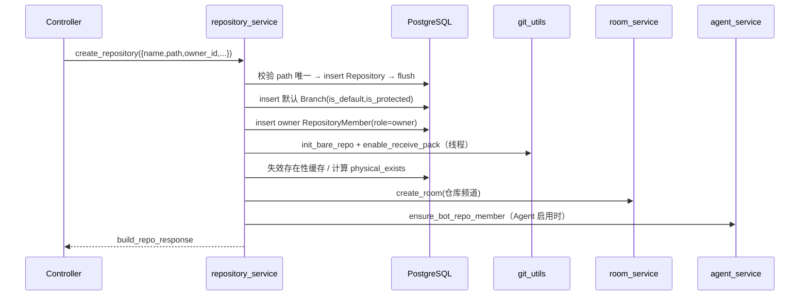
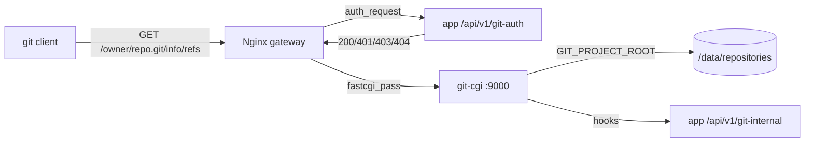

# 07 · Git 与仓库域

> 目标：解释 Kustos 如何存储 Git 仓库、如何读写 Git 对象、如何通过 HTTP/SSH 接入，以及 PR/LFS/保护分支的完整链路。

---

## 1. 存储模型

### 1.1 逻辑路径与物理路径

| 概念 | 形式 | 说明 |
| --- | --- | --- |
| `Repository.path` | `owner/repo` | DB 唯一；用户可见路径 |
| 物理路径 | `<storage.repo_root>/owner/repo.git` | bare 仓库，**必须**以 `.git` 结尾 |
| 默认根 | `./repositories`（dev）/ `/data/repositories`（容器） | 共享卷 `repos` |
| URL（HTTP） | `http://host:port/owner/repo.git` | 由 `git-http-backend` 解析 |

`utils/git_utils.get_repository_storage_path(repo_path, repo_root=None)` 负责拼接并补 `.git`；`ensure_repository_root()` 在启动时创建根目录。

### 1.2 bare 仓库初始化

`init_bare_repo(path, default_branch)`：

1. `pygit2.init_repository(path, bare=True)`；
2. 设置 `HEAD` 符号引用到 `refs/heads/<default_branch>`（与 DB 默认分支对齐，避免 unborn HEAD）；
3. `enable_receive_pack(path)` 写 `http.receivepack=true`（允许 HTTP push）。

> 新仓库是**空仓库、无初始提交**；首次推送由 post-receive 对账补齐分支 tip。

### 1.3 物理存在性缓存

`repository_service`：

- 进程内缓存 + Redis 缓存（TTL 读 `[git] repo_exists_cache_ttl_seconds`，默认 30s）；
- 创建/删除时 `_invalidate_repo_exists_cache()` 主动失效；
- 列表接口通过 `_enrich_repos_with_physical_status()` 返回 `physical_exists`。

---

## 2. Git 封装（`utils/git_utils.py`）

### 2.1 `GitService`

构造时要求物理路径存在且可打开：

```python
GitService(repo_path)                # 不存在 → NotFound；非法 → Validation
GitService.from_repository_id(db, id) # DB 查 repo.path → 物理路径
```

主要方法：

| 方法 | 作用 |
| --- | --- |
| `check_merge_conflicts(src, dst)` | `merge_commits` 试合并，存在冲突返回 True |
| `merge_branches(src, dst, sig, msg)` | 两父合并提交，更新目标分支 |
| `squash_branches(src, dst, sig, msg)` | 单父 squash 提交 |
| `rebase_branches(src, dst, sig)` | rebase 合并方式 |
| `get_branch_commit(branch)` | 取分支 tip |
| `create_signature(name, email)` | 构造 pygit2 签名 |
| 文件/树/diff/blame 等 | 由 `repository_browser_service` 复用底层 |

所有同步 pygit2 调用在请求路径上通过 `asyncio.to_thread` 执行；批量 Git 操作使用模块级 `ThreadPoolExecutor`（`[git] git_thread_pool_workers`，默认 4）。

### 2.2 模块级函数

| 分类 | 函数 |
| --- | --- |
| 仓库 | `init_bare_repo`、`repo_exists`/`repo_exists_async`、`get_repo_info`、`get_repository_storage_path`、`ensure_repository_root`、`_repo_disk_size` |
| 分支 | `get_local_branch_names`、`get_local_branch_heads`、`create_git_branch`、`delete_git_branch`、`set_head_branch`、`resolve_ref_commit`、`get_head_commit` |
| 标签 | `create_git_tag`、`delete_git_tag`、`list_git_tags`、`get_git_tag` |
| diff | `get_pr_diff`、`get_pr_files`、`get_pr_stats`、`get_file_diff`、`_build_diff` |
| 写入 | `commit_file_changes`、`delete_file_changes`、`move_file_changes`（处理 tree/blob、路径校验、大小上限） |
| 配置 | `enable_receive_pack` |

### 2.3 写路径的统一保护

Web 编辑器、协作保存、Agent `commit_file` 都不经 receive-pack，因此由：

```python
ensure_local_write(db, repository_id, branch_name)
```

对“受保护且要求 review/status checks 的分支”禁止直接写入（403 `branch_direct_write_forbidden`）。API 删除分支同样走 `ensure_local_branch_deletable()`。

---

## 3. 仓库生命周期

### 3.1 创建（`repository_service.create_repository`）



- 物理仓库失败**不阻止** DB 创建（告警后可通过重试/修复流程补齐）。
- 房间创建失败、bot 入驻失败均只告警，不阻断主流程。

### 3.2 删除

顺序：物理目录 `shutil.rmtree` → 失效缓存 → 清理搜索索引（外键）→ 删除房间成员/房间 → 删除仓库行。物理删除失败仅告警。

### 3.3 Fork

`fork_service`：创建新 `Repository`（`forked_from_id` 指向源）、复制源 bare 仓库（对象级复制/引用）、建立 owner 成员/房间、递增源 `fork_count`。Fork 的提交行按 `(repository_id, hash)` 各存一份。

### 3.4 归档

`archive_repository` 只改 `is_archived`，不删除数据；写操作由服务层检查归档状态（具体端点按实现）。

---

## 4. 分支、提交与标签

### 4.1 分支

| 操作 | 实现 |
| --- | --- |
| 列表/详情 | `branch_service.get_branches/get_branch`（DB 为准，`commit_hash` 为 tip） |
| 创建 | `_materialize_branch_ref`：显式 ref → 默认分支 → HEAD；先落 Git ref，再写 DB |
| 空仓库 | 仅登记 DB，等首次推送 post-receive 对账 |
| 更新 | `_PROTECTED_BRANCH_FIELDS`（id/repository_id/name/commit_hash）不可经 API 改写 |
| 删除 | 保护校验（受保护分支禁止删除）→ 删 Git ref → 删 DB |
| 保护 | `is_protected`、`require_code_review`、`require_status_checks`、`is_default` |

### 4.2 提交

- DB `commits` 是**索引**而非真相：`(repository_id, hash)` 唯一，`branch_id` 可空。
- post-receive 按 `[git] push_max_commits`（默认 200）有界入库；超限部分由后续推送/浏览路径补齐。
- 分支删除时提交保留（`branch_id` 置 NULL），仓库历史不丢。

### 4.3 标签

`tag_controller` + `git_utils.create_git_tag/delete_git_tag/list_git_tags`；轻量/附注标签信息由 `_tag_info` 读取。

---

## 5. 分支保护

### 5.1 规则来源

DB `Branch` 三个布尔位：`is_protected`、`require_code_review`、`require_status_checks`。规则实现在 `git_event_service.evaluate_branch_ref_update()`，被三处复用：

1. pre-receive（命令行 push）；
2. `ensure_local_write()`（Web/协作/Agent 写）；
3. `ensure_local_branch_deletable()`（API 删分支）。

### 5.2 拒绝条件

| 条件 | 结果 |
| --- | --- |
| 删除受保护分支 | 拒绝 |
| 向受保护分支强推（non-fast-forward） | 拒绝 |
| 受保护分支要求 review/status checks 时直接 push | 拒绝（要求走 PR） |

pre-receive 还检查：

- `storage.max_repo_size`：目录字节数超限拒绝；
- `storage.max_file_size`：遍历新提交 diff，首个超限 blob 拒绝。

### 5.3 合并保护（PR）

`pull_request_service.enforce_merge_protection()`：

1. 目标分支无 DB 记录 → 无保护，放行；
2. `require_code_review` → 至少 1 个**非作者** approve；
3. `require_status_checks` → `evaluate_status_checks()`；当前无 CI 来源，默认“无 CI 即通过”，严格模式（`security.strict_status_checks=true`）下零记录视为不通过；
4. `override=True` → 仅 owner/admin/全局 admin，跳过校验并写 `pr_activities` 审计。

合并前还会 `check_merge_conflicts`，有冲突直接 400。

---

## 6. Git 协议接入

### 6.1 HTTP Smart Protocol



Nginx 关键规则（`docker/gateway/nginx.conf`）：

- `location ~ ^/(?<git_owner>[^/]+)/(?<git_repo>[^/]+\.git)(/.*)?$` → `auth_request /git-auth` → FastCGI；
- `client_max_body_size 2g`（push pack）；
- `/git-auth` 子请求透传 `X-Git-Request-URI` 与 `Authorization`；
- **LFS batch 正则必须排在 Git 正则之前**（git-lfs 端点形如 `/owner/repo.git/info/lfs/objects/batch`）；
- `/api/v1/git-internal/` 在网关返回 404，禁止公网直达内部 hook 回调。

### 6.2 SSH

- `sshd` 容器监听 2222，仅公钥认证，root 禁止；
- `AuthorizedKeysCommand` 从数据库查询全部 `ssh_keys.public_key`；
- 登录 shell 为 `git-shell-wrapper`：接受 `-c` 指定的 git 命令并委托 `/usr/bin/<cmd>`，路径映射到 `/data/repositories/<path>`（**当前未做命令白名单**）；
- hooks 与 HTTP 共用 `/opt/kustos/hooks`；
- `repos` 卷属主对齐 uid=1000（容器内 `git` 用户）。

> 安全注意（现状）：`docker/ssh/authorized_keys_query.py` 中硬编码了内部数据库 DSN（与 compose 的 `KUSTOS_DB_URL` 不一致），且 `git-shell-wrapper` 对 `-c` 命令使用 `eval`。生产部署前建议改为读取环境变量并对命令做白名单校验。

### 6.3 Git hooks

| hook | 行为 | 失败语义 |
| --- | --- | --- |
| `pre-receive` | 收集 `refs/heads/*` 更新 → `POST /git-internal/pre-receive`（共享密钥） | **fail-closed**：hook.conf 缺失/密钥为空/应用不可达/非 200 → 拒绝推送 |
| `post-receive` | 收集 heads+tags → `POST /git-internal/post-receive` | **永不阻断**，失败仅日志，下次推送自愈 |

`hook.conf` 由容器启动时生成（含 URL/密钥/仓库根，`umask 077`；sshd 内需 chown 给 git 用户，否则 hook 以 git 身份无法读取）。

---

## 7. LFS

### 7.1 两层授权

| 层 | 凭证 | 裁决 |
| --- | --- | --- |
| batch 入口 `POST /repositories/{repo_id}/lfs/objects/batch` | Bearer access token 或 Basic | `lfs:read` / `lfs:write`；公开仓读放行；私仓需成员 |
| 传输端点 upload/download/verify/delete | 仅短时效 **LFS transfer token** | 签名 + 过期 + repo 绑定 + scope + 撤销 + 用户活跃 |

- transfer token 默认 5 分钟（`lfs.transfer_token_ttl_minutes`），放进 action 的 `header`，**不放 URL query**（避免日志泄漏）。
- 存储：`{lfs.local_path}/{repo_id}/objects/...`，跨仓不可读。
- oid 必须是 64 位小写 hex，防止路径穿越/探测。
- `storage_backend=s3` 未实现，端点返回 501。

### 7.2 网关放行

git-lfs 默认端点 `/owner/repo.git/info/lfs/objects/batch` 由 Nginx 单独规则转发到 `/api/v1/lfs/{owner}/{repo}/batch`，不走 `/git-auth`（否则上传会被 `repo:read` 误判），并放宽 `client_max_body_size 2g`。

---

## 8. 代码浏览

`repository_browser_service` 全部为 pygit2 只读（`offload_to_thread`）：

| 函数 | 返回 |
| --- | --- |
| `get_tree_entries(repo, ref, path)` | 目录条目 + 最后提交 |
| `get_blob_content` | 文本/二进制内容、语言、大小 |
| `get_commits` | 提交历史（分页） |
| `get_diff` | 两 ref 间 diff（序列化） |
| `get_blame` | 行级 blame |
| `get_commit_graph` | 提交图节点/边/标签 |
| `compare` | 分支/提交对比 |
| `get_readme_content` | README 渲染源 |
| `detect_file_language` | 扩展名/文件名映射 |
| `get_file_symbols` | 正则/语法符号大纲 |
| `commit_file` / `remove_file` / `move_file` | Web 端写操作（走保护裁决 + 大小校验） |

路径安全：拒绝 `..`、绝对路径、空段；非法路径抛 `InvalidPathException`（400）。

---

## 9. 限制与失败模式

| 限制 | 值/来源 |
| --- | --- |
| 单仓库大小 | `storage.max_repo_size`（默认 1GB），push 后/推送中校验 |
| 单文件大小 | `storage.max_file_size`（默认 100MB），push diff 与本地写校验 |
| 单次推送入库提交 | `git.push_max_commits`（默认 200） |
| Git 线程池 | `git.git_thread_pool_workers`（默认 4） |
| 存在性缓存 | `git.repo_exists_cache_ttl_seconds`（默认 30s） |
| LFS 单文件 | `lfs.max_upload_size`（默认 5GB） |

| 失败模式 | 表现/恢复 |
| --- | --- |
| 物理仓库缺失 | 列表标记 `physical_exists=false`；创建/修复流程可补 |
| DB 分支与磁盘不一致 | post-receive 全量对账；默认分支漂移由 `sync_repository_default_branch` 修复 |
| 推送被 hook 拒绝 | 应用返回原因，hook 回显并 exit 1 |
| 应用不可达 | pre-receive fail-closed；post-receive 跳过待自愈 |
| LFS token 过期 | 重新 batch 换取新 token |

---

## 10. 相关源码

- `backend/app/utils/git_utils.py`
- `backend/app/services/repository/repository_service.py`、`branch_service.py`、`commit_service.py`、`tag_controller.py`
- `backend/app/services/repository/repository_browser_service.py`
- `backend/app/services/collaboration/pull_request_service.py`
- `backend/app/services/integration/git_event_service.py`
- `backend/app/api/v1/git_auth_controller.py`、`git_hook_controller.py`
- `backend/app/api/v1/lfs_controller.py`、`services/lfs_*.py`
- `docker/gateway/nginx.conf`
- `docker/git-cgi/`、`docker/ssh/`、`docker/git-hooks/`
- 测试：`test_branch_protection_merge.py`、`test_git_hook_api.py`、`test_lfs_*.py`、`test_repository_browser_service_async.py`
