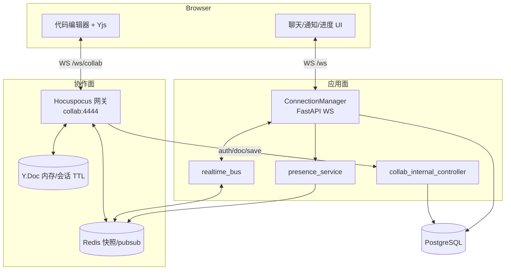
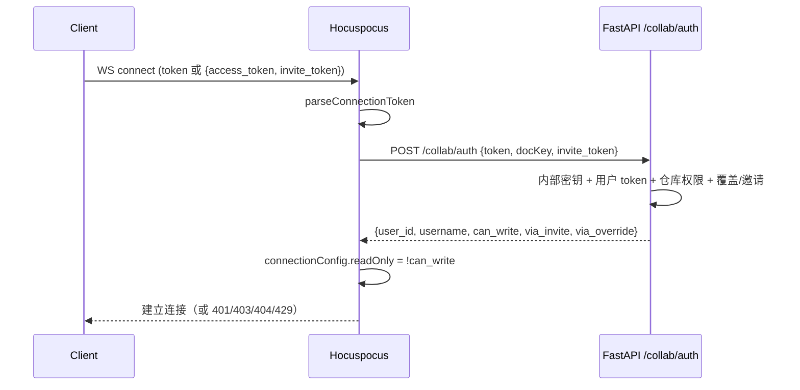
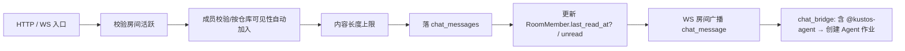

# 08 · 协作与实时系统

> 目标：解释「多人实时编辑」「WebSocket 推送」「聊天/在线状态」三套机制的边界与协作方式。

---

## 1. 系统分层



> 边界：**CRDT 同步由 Hocuspocus 负责**；业务鉴权、文档加载、保存落 Git 全部回到 FastAPI（内部共享密钥）。WebSocket 聊天/通知走 FastAPI 自己的 `ConnectionManager`，与协作网关无关。

---

## 2. 协作编辑（Hocuspocus + Yjs）

### 2.1 文档标识

```
docKey = "<repository_id>:<branch>:<path>"
```

控制器 `parse_doc_key()` 校验为三段；仓库、分支、路径解析后逐次鉴权。Y.Doc 中唯一共享文本类型为 `getText("content")`，客户端必须同名。

### 2.2 连接鉴权



- **普通用户**：access token；按仓库角色 `collab:read/write` 裁决。
- **邀请访客**：`{access_token, invite_token}` JSON；邀请 token 提供会话级写权限，仍需用户身份。
- **会话覆盖**：`collab_session_overrides` 的 `scope` 优先于仓库角色/邀请；`is_kicked=true` 直接拒绝。
- **连接数上限**：单文档默认 50（`KUSTOS_COLLAB_MAX_CONNECTIONS_PER_DOC`），超限 429/4429。

### 2.3 文档加载与播种

- `afterLoadDocument`：若 Y.Text 已有内容（Redis 快照/对端同步）→ 跳过 Git 播种。
- 多副本：`seedGuard`（Redis 锁）串行化，等待对端文本最多 5s，避免各自 insert 造成重复内容。
- 从 Git 读取：`GET /collab/doc`；404 文件不存在、415 二进制不支持、413 超内容上限。
- 内容上限默认 2,000,000 字符。

### 2.4 保存

只有显式 `stateless {"type":"collab-save"}` 才落 Git：

1. 网关校验 `context.can_write`、内容上限；
2. `POST /collab/save {token, docKey, content, message, invite_token, draft}`；
3. 应用**实时**校验写权限（不缓存）、邀请/覆盖、内容上限；
4. 以提交者身份写 Git（`draft=true` 写草稿分支）；
5. 更新搜索索引（`SearchService.update_files`）；
6. 网关递增版本号，广播 `collab-saved {docKey, commit_id, version}`（不泄露 saved_by/message 等元数据）。

`onStoreDocument` 的 debounce/断开自动触发**不提交 Git**，只写 Redis 会话快照，避免高频 commit。

### 2.5 会话 TTL 与多副本

| 机制 | 说明 |
| --- | --- |
| `sessionTtl.mjs` | 最后一名协作者离开后保留内存 Y.Doc（默认 600s），窗口内重进可复用现场 |
| `redisPersistence.mjs` | 配置 `REDIS_URL` 后启用跨副本 pub/sub 与会话快照持久化；未显式保存的编辑也能跨副本/短重启恢复 |
| `versionCounter.mjs` | 单调递增版本号（Redis 持久计数，回退进程内），供“会话已同步（版本 N）” |
| `seedGuard` | 跨副本播种互斥 |
| 连接计数 | 每副本独立 Map；多副本时上限按副本生效 |

### 2.6 Awareness 策略与跟随

`beforeHandleAwareness`：

- 用连接上下文**盖章** `user {user_id, name}`，防客户端冒名；
- 归一化 `viewport {anchor}`、`follow {target|null}`、`unsaved(bool)`；
- 单条 awareness 超过 `MAX_AWARENESS_BYTES`（默认 8KB）时，先删扩展字段，再删白名单外字段，最后收敛为最小身份。

跟随模式（Follow me）走 stateless `collab-spotlight`：仅写权限者可发起，网关广播 `{from:{user_id,username},on}`；发起者断开自动广播 `on:false`。

### 2.7 协作管理 API

| 端点 | 说明 |
| --- | --- |
| `POST /repositories/{repo_id}/collab/invites` | 创建邀请（默认 60min，最长 1440min） |
| `DELETE .../collab/invites/{jti}` | 撤销邀请（`collab_invite_revocations`） |
| `PUT .../collab/sessions/{doc_key}/overrides` | 设置成员 scope / 踢人 |
| `DELETE .../overrides/{user_id}` | 移除覆盖 |

---

## 3. FastAPI WebSocket

### 3.1 连接模型

`api/ws/manager.py`：

```python
class Connection:
    websocket, connection_id
    user_id, username
    repository_ids: set[UUID]
    rooms: set[UUID]
    last_ping
    metadata
```

`ConnectionManager`（真单例，模块导出名 `manager`）：

- `_connections: id → Connection`
- `_user_index` / `_repository_index` / `_room_index`
- `connect/disconnect/bind_user/subscribe_repository`
- `send_to_user` / `send_to_room` / `broadcast`
- `heartbeat_checker()`：定期清理超时连接
- `set_presence(presence_store)`

### 3.2 认证

`api/ws/auth.py`：

- token 从 `Sec-WebSocket-Protocol: kustos-bearer, <jwt>` 读取（兼容已废弃 query token）；
- 校验 JWT、token 撤销、用户存在/激活；
- 支持 `required` / `anonymous` 模式；
- 失败以策略码关闭（如 1008）。

`/ws/logs` 额外要求 `is_admin`。

### 3.3 处理器

| 处理器 | 消息 |
| --- | --- |
| `handlers/chat.py` | `chat_message`、`chat_typing`、`chat_reaction`；落库 + 房间广播 |
| `handlers/room.py` | `room_join`、`room_leave`、`presence_list` |
| `handlers/notification.py` | `ping`、`subscribe`/`unsubscribe`、`broadcast`；`notify_commit_new`/`notify_branch_update`/`notify_repository_event`/`notify_user` |
| `handlers/progress.py` | 长任务进度上报/查询/完成/失败 |
| `handlers/sync.py` | 仓库同步开始/完成/失败/文件变更广播 |
| `handlers/log_handler.py` | 日志缓冲（默认 10k 条）、订阅过滤、`WebSocketLogHandler` |

处理器按需注册（`register_all_handlers()`），避免模块导入副作用。

### 3.4 跨 worker 广播

`utils/realtime_bus.py`：

```
send_to_user / send_to_room / broadcast
  → 本地 manager 直投
  → Redis publish(channel, {origin: WORKER_ID, scope, target, message})
  → 各 worker 订阅循环：origin == 自己 → 跳过；否则本地投递
```

- 每条消息对每个连接恰好一次。
- Redis 不可用：`start()` 返回 False，退化为进程内广播；`publish()` 按冷却窗惰性重连。
- 降级登记 `degraded: realtime_bus`。

### 3.5 在线状态

`services/realtime/presence_service.py`：

- Redis HASH 引用计数：`kustos:presence:room:<room_id>:n`（user → 连接数）、`:name`（user → username）。
- TTL 默认 90s，由心跳续期；worker 崩溃后自动过期。
- Redis 不可用 → no-op，manager 回退本进程 `_room_index`，Admin 显示 degraded。

---

## 4. 聊天、房间与私聊

### 4.1 房间模型

- `RealtimeRoom`：仓库频道（`repository_id` 唯一）或 DM（`room_type="dm"`）。
- `RoomMember`：`role`(member/admin)、`joined_at`、`last_read_at`、`is_muted`。
- 仓库创建时自动建频道并把 owner 设为 admin；Agent 启用时 bot 预置为成员。

### 4.2 消息发送（`ChatService.send_message`）



- 内容上限 `[realtime] chat_max_content_length`（默认 10000）。
- REST 与 WS 共用 `ChatService`，避免入口漏接。
- @bot 桥接失败（未启用/无 key/配额/权限）只回 bot 提示，不影响消息本身。

### 4.3 私聊

`DirectMessage` 以 `(user_a_id, user_b_id)` 规范化排序唯一；一个 DM 会话对应一个 `room_type="dm"` 的 `RealtimeRoom`。创建时复用已存在会话。

### 4.4 附件

`attachment_service`：上传到 `storage.upload_root/attachments`，校验大小（默认 20MB）与文件名（防穿越），按 content-type 下载。

---

## 5. 通知

`notification_service.create_notification()`：

1. 落 `notifications`；
2. 若 `send_email` 且偏好允许 → `send_notification_email`（SMTP，`utils/email_utils`）；
3. 读取最新未读数；
4. `notify_user(user_id, type, data, unread_count)` → WS 推送。

偏好表 `notification_preferences` 按用户唯一，控制各类型邮件开关。

---

## 6. 关键配置

| 配置 | 默认 | 作用 |
| --- | --- | --- |
| `realtime.ws_heartbeat_timeout_seconds` | 120 | WS 心跳超时 |
| `realtime.ws_max_message_bytes` | 256KB | 单条消息上限 |
| `realtime.presence_ttl_seconds` | 90 | 在线状态 TTL |
| `realtime.chat_max_content_length` | 10000 | 聊天内容上限 |
| `realtime.collab_save_max_content_chars` | 2,000,000 | 协作保存上限 |
| `realtime.log_buffer_max` | 10000 | 日志缓冲 |
| `collab.invite_default_ttl_minutes` | 60 | 邀请默认有效期 |
| `collab.invite_max_ttl_minutes` | 1440 | 邀请最长有效期 |
| `KUSTOS_COLLAB_SESSION_TTL_MS` | 600000 | 网关会话保留 |
| `KUSTOS_COLLAB_MAX_CONNECTIONS_PER_DOC` | 50 | 单文档连接上限 |
| `KUSTOS_COLLAB_MAX_CONTENT_CHARS` | 2,000,000 | 网关内容上限 |
| `KUSTOS_COLLAB_MAX_AWARENESS_BYTES` | 8192 | awareness 单条上限 |

---

## 7. 失败与降级矩阵

| 依赖失败 | 影响 | 降级 |
| --- | --- | --- |
| Redis 不可用 | 跨 worker 广播/presence/快照 | 进程内广播、本进程 presence、协作网关单副本 |
| 协作网关不可用 | 无法多人编辑 | 编辑器只读/本地模式；其他功能不受影响 |
| 内部密钥未配置 | `/collab/*` 503 | 安全默认，禁止协作 |
| WebSocket 断开 | 实时推送中断 | 前端轮询 + 重连；`agent_step` 可轮询步骤 |
| 邀请 token 过期 | 访客写失败 | 重新生成邀请 |
| 权限被吊销 | 保存 403 | 网关断开连接（4403）强制重认证 |
| 文档过大 | 加载/保存拒绝 | 413，提示拆分文件 |
| 连接数超限 | 新连接拒绝 | 429/4429 |

---

## 8. 相关源码

- `backend/collab-gateway/server.mjs`、`sessionTtl.mjs`、`versionCounter.mjs`、`redisPersistence.mjs`
- `backend/app/api/v1/collab_internal_controller.py`、`collab_invite_controller.py`、`collab_session_controller.py`
- `backend/app/services/collab_invite_service.py`、`collab_session_service.py`
- `backend/app/api/ws/manager.py`、`auth.py`、`router.py`、`handlers/`
- `backend/app/utils/realtime_bus.py`
- `backend/app/services/realtime/*`
- `backend/app/services/agent/chat_bridge.py`
- 测试：`collab-gateway/tests/*`、`test_chat_*`、`test_presence_*`、`test_room_*`、`test_realtime_bus.py`、`test_collab_*`
