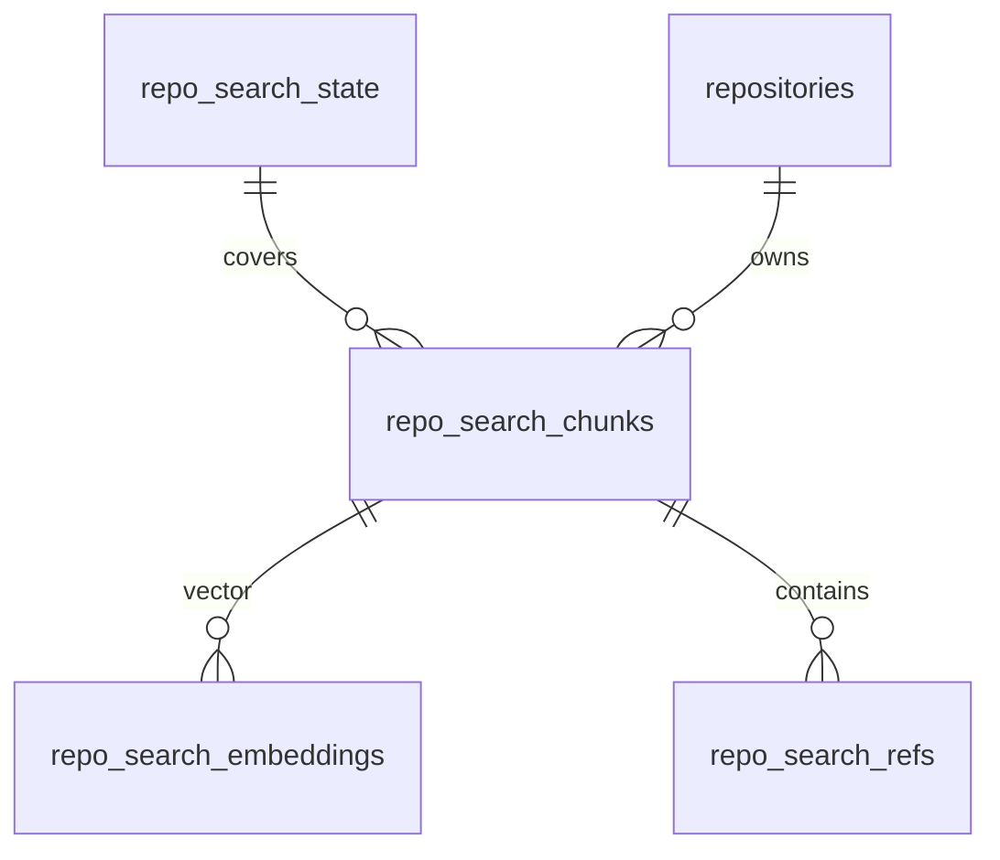
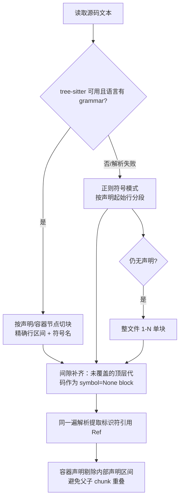
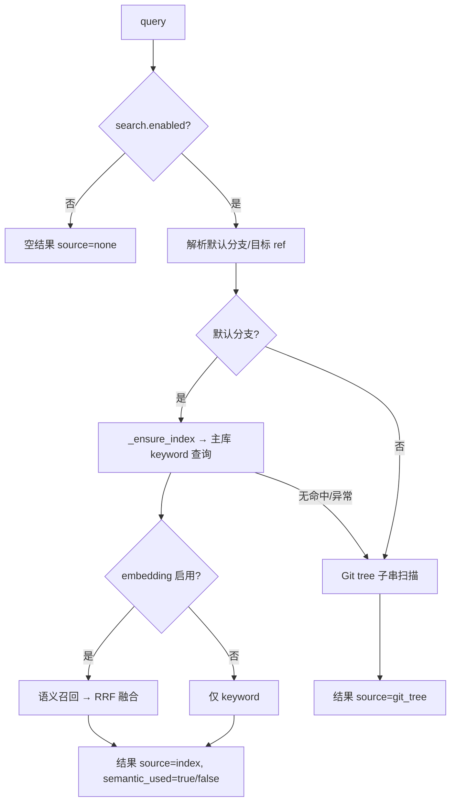

# 09 · 搜索与索引

> 目标：解释代码搜索如何在不依赖工作树、不引入外部搜索引擎的前提下，做到“块级定位 + 符号图 + 语义混合 + 永远可兜底”。

---

## 1. 设计原则

| 原则 | 含义 |
| --- | --- |
| 真相在 Git | 所有内容来自 pygit2 读取的 ref/tree/blob；bare 仓库无工作树 |
| 主库持久化 | 索引存 PostgreSQL（`repo_search_*`），不引入 ES/向量库 |
| 块级而非文件级 | 命中返回 `file:start-end`，显著降低 Agent 上下文 token |
| 永远可兜底 | 索引缺失/超限/不可用时退回 Git tree 子串扫描，结果正确 |
| 懒构建 + 增量 | 请求路径按需补齐；push/PR merge/协作保存按 diff 增量更新 |
| 代次自愈 | `index_generation` 不符或缺失 → 全量重建，避免“状态行有效但数据行为空” |

---

## 2. 数据结构

| 表 | 粒度 | 用途 |
| --- | --- | --- |
| `repo_search_state` | 仓库 1 行 | `indexed_commit` + `index_generation`；增量基线/自愈 |
| `repo_search_chunks` | 每符号块 1 行 | `(path, chunk_index, symbol, kind, start_line, end_line, content, size)`；B-tree `(repo,symbol)` 与唯一约束 |
| `repo_search_refs` | 每引用 1 行 | `(path, name, line)`；definition/usages 的引用图 |
| `repo_search_embeddings` | 每块每模型 1 行 | `pgvector vector(1536)`；语义近邻 |
| `repo_commit_files` | 每提交每文件 1 行 | 变更图：状态/增删行/改动区间 |
| `repo_commit_index_state` | 仓库 1 行 | 变更图索引基线 + 代次 |

索引维度常量：`models/vector_type.py:VECTOR_DIM = 1536`。`search.embedding_dim` 与之不一致时启动告警。

---

## 3. 切块（`indexing/chunker.py`）

### 3.1 三级降级

覆盖语言：Python、JavaScript、TypeScript/TSX、Go、Rust、Java、C、C++、Ruby、PHP（grammar 编译进 wheel）；其他语言走正则/整文件兜底。

### 3.2 产出

`analyze_file(path, text)` → `(chunks: list[Chunk], refs: list[Ref])`

- `Chunk`：path、symbol、kind、start_line、end_line、content（1-based 闭区间）。
- `Ref`：标识符引用（`MIN_REF_LEN=2`），供符号/引用图。

### 3.3 护栏

| 常量 | 默认 | 行为 |
| --- | --- | --- |
| `MAX_CHUNK_LINES` | 400 | 超限声明按行切小段 |
| `MAX_CHUNK_BYTES` | 64KB | 超限切分 |
| `MAX_CHUNKS_PER_FILE` | 200 | 病态文件截断 |
| `MAX_REFS_PER_FILE` | 4000 | 病态引用截断 |

均可经 `[search] chunk_max_*` 热配置。

---

## 4. 索引生命周期

### 4.1 懒构建（请求路径）

`SearchService._ensure_index(db, repository_id, repo_path)`：

1. 读 `repo_search_state`；
2. 若 `indexed_commit == HEAD` 且代次匹配 → 直接返回；
3. 否则尝试抢 per-repo 重建锁 → 全量/增量补齐；
4. 未抢到锁 / 超资源上限 → 跳过，查询退回 Git tree。

### 4.2 全量重建

`rebuild_index(db, repository_id, repo_path)`：

- 进程内 `asyncio.Lock` + Redis `SET NX`（TTL `rebuild_lock_ttl`，默认 180s）；
- 未抢到锁返回 0；
- `_do_rebuild`：遍历默认分支 HEAD 文本文件 → 分批（`index_file_batch`）读取/切分 → 分批（`index_row_batch`）INSERT chunk/ref → 可选生成 embedding → 写 state（commit + generation）；
- 清理缺失文件残留；`cleanup_index()` 在仓库删除时清四表。

### 4.3 增量更新

`update_files(db, repository_id, repo_path, changed_files)`：

- 由 push / PR merge / 协作保存触发；
- 锁语义同重建；
- `_delete_paths` 清该路径 chunk/ref/embedding → `_extract_changed` 重切 → 插入 → `_upsert_state`；
- 仅重切变更文件，不重扫全仓。

### 4.4 资源护栏

| 配置 | 默认 | 超限行为 |
| --- | --- | --- |
| `index_max_files` | 5000 | 跳过大仓库索引，搜索退回 Git tree |
| `index_max_bytes` | 32MB | 同上 |
| `scan_file_limit` | 200 | 候选文件扫描上限 |
| `symbol_scan_max_files/bytes` | 2000 / 16MB | 非默认 ref 现场扫描护栏，超限 `partial=true` |
| `max_file_size` | 2MB | 单文件（索引/扫描/兜底）上限 |
| `commit_index_max_commits` | 300 | 变更图单次构建/回填上限 |

---

## 5. 查询路径

### 5.1 `search_code`

返回 `SearchResponse`：

- `results`: `{file, line, content, symbol, start_line, end_line}`（块级区间）；
- `total_count`: 截断时为 -1；
- `truncated`: 是否达到上限；
- `source`: `index` / `git_tree` / `none`；
- `semantic_used`: 是否真正走了语义召回。

**上限**：`search.max_results`（默认 100）是服务默认兼硬上限，显式传参也会被夹取。

### 5.2 关键词检索

- PostgreSQL：`content ILIKE '%q%'`；
- 代码注释声称由 `pg_trgm` GIN 索引加速，但 **`0001_initial` 迁移只创建了 B-tree 索引**（`(repo,symbol)`、`(repo,path,chunk_index)`），未 `CREATE EXTENSION pg_trgm` 或 GIN 索引——实际执行计划可能退化为顺序扫描；
- 路径前缀过滤、测试文件排除（`_is_test_path`）；
- 空结果不冒充索引召回，降级 `git_tree`。

### 5.3 语义检索与 RRF

- `get_embedding_provider()`：显式入参 > 环境变量（`search.embedding_api_key_env`，默认 `KUSTOS_AGENT_API_KEY`）> `config_secrets(search.embedding_api_key)`；
- 未配置 → `NotConfiguredEmbeddingProvider`，语义静默退化为关键词；
- 查询向量有进程内 LRU（容量/TTL 可配）；
- `_rrf_fuse([keyword, semantic], max_results, k)`：按 `(file, chunk)` 归并，`score = Σ 1/(k + rank)`；
- `embedding_build_budget` 控制单次索引的 embedding 总预算，超时跳过剩余批次。

### 5.4 符号与引用

| 方法 | 数据源 | 语义 |
| --- | --- | --- |
| `find_definition(name)` | `repo_search_chunks.symbol == name` | 精确符号定义（默认分支 HEAD） |
| `find_usages(name)` | `repo_search_refs.name == name` + LEFT JOIN chunk | word 级引用，返回所在符号上下文 |
| 非默认 `ref` | 现场扫描 Git tree | `source=git_tree`，超护栏 `partial=true` |

`exclude_tests` 通过测试路径规则过滤；Agent 工具直接复用这两条路径。

### 5.5 跨仓库搜索

`search_controller.global_search_router`（`/api/v1/search`）在用户可访问仓库集合内聚合，受 `get_accessible_repository_ids` 约束。

---

## 6. 变更图索引（`commit_index_service`）

用途：让 Agent 的 `review_recent_changes` / `who_changed` 一次查询拿到“某提交改了哪些文件、哪些行”，避免 `log → diff → read×N` 多轮往返。

- 数据源：pygit2 逐提交与第一父 diff（根提交与空树 diff）；
- 行区间：新侧 hunk `[new_start, new_start+new_lines-1]`；
- 懒构建/增量/代次自愈与搜索索引同构；
- `COMMIT_INDEX_GENERATION` 升级强制重建。

---

## 7. API 与配置

| 端点 | 说明 |
| --- | --- |
| `GET /repositories/{id}/search?q=&path=&ref=&semantic=` | 代码搜索 |
| `GET /repositories/{id}/symbols/{name}/definition` | 定义 |
| `GET /repositories/{id}/symbols/{name}/usages` | 引用 |
| `GET /repositories/{id}/search/index-status` | 索引状态（commit/generation/文件数） |
| `POST /repositories/{id}/search/reindex` | 手动重建（并发锁返回 0/已在进行） |
| `GET /api/v1/search?q=...` | 跨仓库搜索 |
| `/api/app/search/*` | 管理面状态/重建/embedding 凭据 |

配置节 `[search]` 全部热生效（`ConfigSection(hot=True, writable=True)`）。

---

## 8. 降级与边界

| 场景 | 行为 |
| --- | --- |
| 索引表未迁移/不可读 | 捕获异常 → rollback → Git tree 扫描 |
| 大仓库超护栏 | 不建索引，每次 Git 扫描（正确但慢） |
| embedding 未配置/key 失效 | 语义跳过，关键词照常；`semantic_used=false` |
| 重建锁被占 | 本次返回 0，查询走兜底 |
| 非默认 ref | 现场扫描，超护栏标记 partial |
| `search.enabled=false` | 空结果，Agent 搜索工具同步禁用 |
| pgvector 维度不符 | 启动告警；索引写入可能失败，查询降级 |

---

## 9. 性能建议

1. 建议为 `repo_search_chunks.content` 创建 `pg_trgm` GIN 索引（当前迁移未创建，ILIKE 可能全表扫描）；同时保持 `(repo,symbol)` B-tree。
2. 合理设置 `index_max_files/bytes`：超大 monorepo 建议提高上限或接受 Git 扫描。
3. 语义检索成本敏感：控制 `embedding_batch`、`embedding_concurrency`、`embedding_build_budget`。
4. 变更图索引按需构建（Agent 首次使用时），避免每次 push 全量算。
5. 默认分支增量更新依赖 push/merge 传入的变更文件列表；若发现索引滞后，调用 reindex。

---

## 10. 相关源码

- `backend/app/services/search/search_service.py`
- `backend/app/services/search/search_admin_service.py`
- `backend/app/services/indexing/chunker.py`、`embeddings.py`、`vector_type.py`
- `backend/app/services/repository/commit_index_service.py`
- `backend/app/models/repo_search*.py`、`repo_commit_file.py`
- `backend/app/api/v1/search_controller.py`、`search_admin_controller.py`
- 测试：`test_search_service.py`、`test_search_semantic_tuning.py`、`test_chunk_*.py`、`test_embeddings.py`、`test_commit_index_service.py`、`test_index_debt.py`
