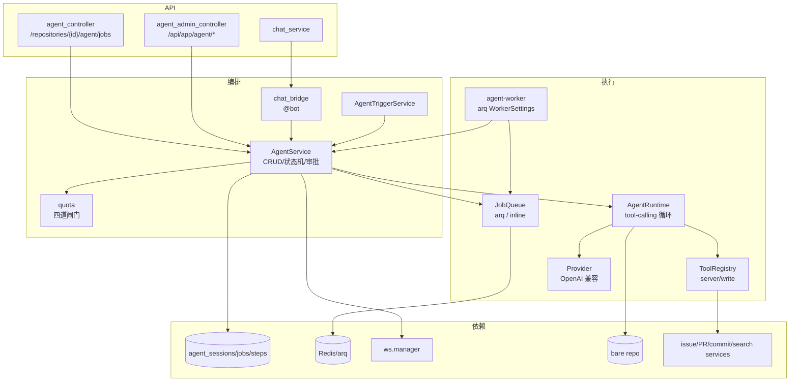
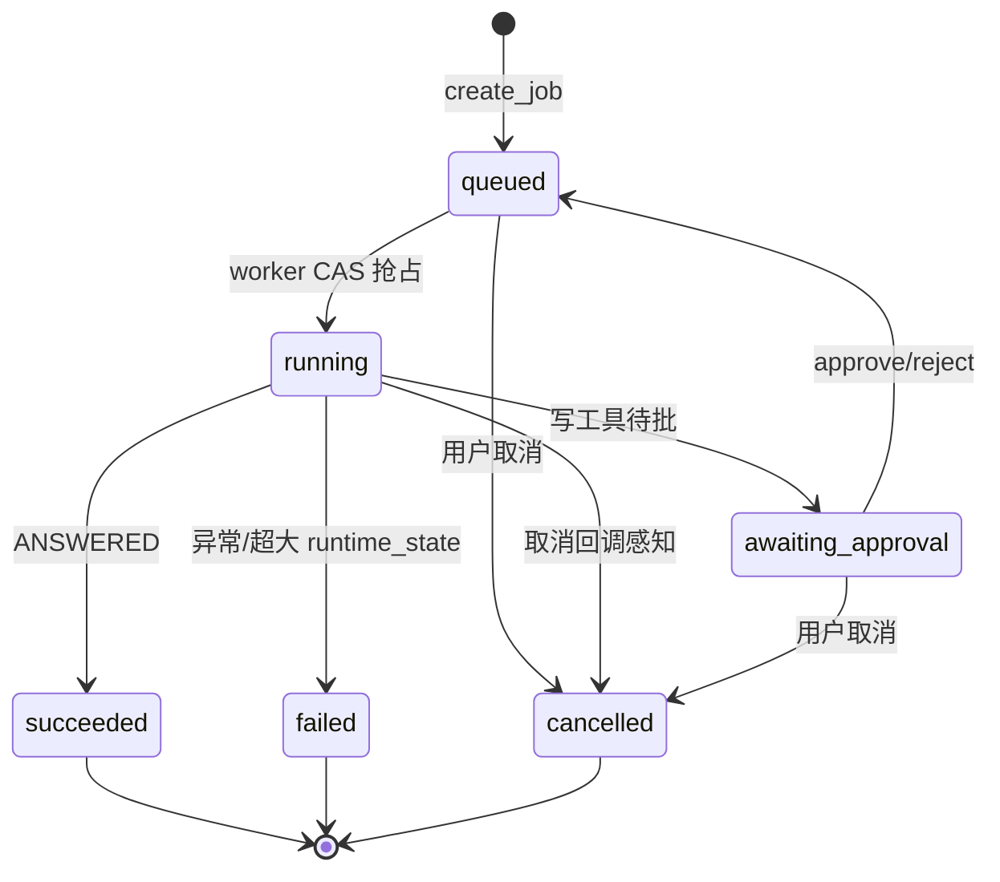
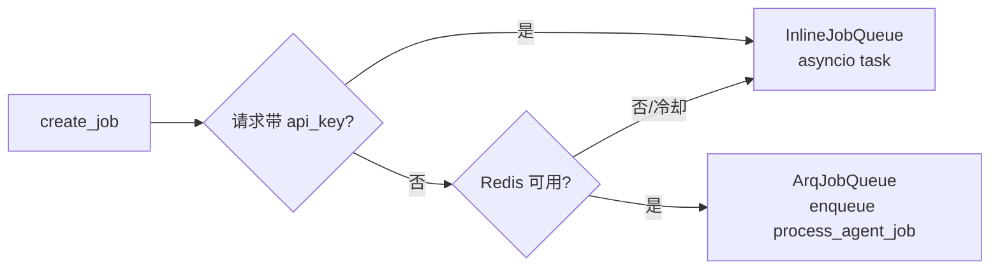

# 10 · 内置 Agent

> 目标：完整解释 Agent 的作业状态机、工具循环、人工审批、队列/worker、配额、触发器与安全边界。

---

## 1. 组件总览



---

## 2. 数据模型

| 表 | 作用 |
| --- | --- |
| `agent_sessions` | 用户 × 可选仓库的会话；`summary` 为确定性会话摘要（无额外模型调用） |
| `agent_jobs` | 一次 prompt → 工具循环 → 回答；状态、token 统计、审批字段、`runtime_state` |
| `agent_steps` | 有序步骤（user/assistant/tool_call/tool_result/error/approval_required），checkpoint + 流式事件 |
| `agent_triggers` | 仓库 × 事件类型的触发规则（push/build_failed/schedule） |
| `agent_trigger_runs` | `(trigger_id, dedup_key)` 去重与审计 |

`AgentJob.origin`：`user`（面板/API/聊天）或 `trigger`（自主只读）。

---

## 3. 作业状态机



**并发安全**：所有终态写入走 `_cas_status()`（`UPDATE … WHERE status = 前置状态`）。取消与执行器收尾竞争时只有一方生效，不会“取消后又被覆盖成成功”。

**僵尸回收**：`reclaim_stale_jobs()` 把超过 `stale_job_timeout_minutes`（默认 15）无更新的 `queued`/`running` 作业 CAS 为 failed，并追加 error 步骤；`awaiting_approval` 不回收。

---

## 4. 作业创建（`AgentService.create_job`）

顺序：

1. **kill switch**：`agent.enabled=false` → 403 `agent_disabled`；
2. prompt 非空、截断到 `max_prompt_chars`；
3. **仓库读权限**：`get_accessible_repository_ids` 必须包含目标仓库（否则 404，避免泄露）；
4. **配额**：`enforce_agent_quota`；命中并发上限时先尝试回收僵尸再复核；
5. **请求级 base_url**：必须同时携带 `api_key`；
6. **SSRF**：仅校验请求级 base_url ∈ `allowed_base_urls`（配置级 base_url 视为管理员可信）；
7. 会话：指定 `session_id` 必须属于当前用户；否则新建；
8. 落 `agent_jobs(queued)` + Activity（同一事务）；
9. 入队：
   - 带内存 key → `InlineJobQueue`（密钥不进入 Redis/arq 载荷）；
   - 否则 → `get_job_queue()`（Redis 可用 arq，否则内联）。

---

## 5. 执行循环（`agent/runtime.py`）

### 5.1 两阶段循环

每一轮：

1. **取消检查**：`is_cancelled` → `CANCELLED`；
2. **token 预算**：累计 ≥ budget → `BUDGET_EXCEEDED`（保留已有结论 + 收尾提示）；
3. **待执行工具调用**：扫描全部消息，找出尚未回填 `tool` 结果的 `assistant.tool_calls`：
   - 写工具 + `requires_approval` + `allow_write` 且无审批决定 → 返回 `AWAITING_APPROVAL`（持久化 pending + messages）；
   - 用户拒绝 → 回填 `{"error": "用户拒绝了该操作，未执行"}`；
   - 否则执行工具 → 追加 `role=tool` 消息；
4. **调用模型**：`provider.complete(messages, tools, on_delta=...)`；
5. 无工具调用 → `ANSWERED`；有 → 追加 assistant tool_calls，进入下一轮。

### 5.2 关键特性

| 特性 | 实现 |
| --- | --- |
| 恢复执行 | 挂起时 `RunOutcome.messages` 原样存 `runtime_state`；恢复时作为 `history` 前置，无需从 steps 反推 |
| 审批门禁 | `ToolSpec.requires_approval`；写工具无显式决定绝不执行 |
| 取消感知 | 每轮前查 DB 状态（独立短会话） |
| 流式 | provider 支持 `on_delta` 时逐 delta 回调；聊天桥按 400 字/0.15s 攒批推送 |
| 工具结果截断 | 各工具自夹取并置 `truncated`；runtime 兜底 `max_tool_result_chars`，触发即告警 |
| 步数上限 | `max_steps`（默认 8），超出抛 `MaxStepsExceeded` → failed |
| 写权限二次校验 | `_can_write`：`has_repo_action(AGENT_WRITE)` |
| 写工具审计 | 成功执行才落 `activities`（被拒/出错无副作用不记） |

### 5.3 `allow_write` 的三种来源

```python
allow_write = (origin != "trigger") and (provider_override is None)
```

- 触发器作业：无人可批 → 只读；
- 请求自带 key：审批挂起后 worker 取不到 key → 只读（避免“永远无法批准”的确认卡片）；
- 普通作业：允许写，但每个写工具仍需审批。

---

## 6. 工具

### 6.1 注册表

`ToolSpec`：name、description、parameters(JSON Schema)、handler、plane(`server`/`local`)、scope(`repo:read`/`repo:write`)、`requires_approval`。

`openai_tools(allow_write)` 按作业能力过滤；`allow_write=false` 不暴露任何写工具。

### 6.2 只读工具（`tools_server.py`）

| 工具 | 数据源 |
| --- | --- |
| `search_code` | `SearchService.search_code`（块级结果 + semantic 标记） |
| `find_definition` / `find_usages` | 符号索引/引用图 |
| `read_file` | Git blob（受 `read_file_max_chars` 截断） |
| `list_tree` | Git tree（受 `list_tree_max_entries`） |
| `list_pull_requests` / `get_pull_request` | PR 服务 |
| `list_issues` / `get_issue` | Issue 服务 |
| `list_members` / `responsible_for` | 成员与代码归属 |
| `list_channel_messages` / `search_chat_decisions` | 聊天记录（团队决策检索） |
| `list_commits` / `get_commit` / `get_diff` / `blame_file` / `compare_refs` | Git |
| `get_build_status` / `get_build_logs` | 构建状态/日志 |
| `review_recent_changes` / `who_changed` | 变更图索引（`repo_commit_files`） |

### 6.3 写工具（`tools_write.py`，全部 `requires_approval=True`）

`create_issue`、`comment_on_issue`、`set_priority`、`apply_label`、`comment_on_pull_request`、`create_pull_request`、`retry_build`、`commit_file`。

- 执行前：`allow_write` + 仓库写角色；
- `commit_file` 走分支保护裁决（`ensure_local_write`）；
- 成功写操作落 Activity（实体锚点 = `job.id`）。

---

## 7. 队列与 worker

### 7.1 队列选择



- arq 连接池创建失败按冷却窗重试，不会永久退化；期间登记 `degraded: agent_queue=inline`。
- `ArqJobQueue` 拒绝携带 provider override（密钥不得进入队列载荷）。

### 7.2 arq Worker（`agent/worker.py`）

```bash
arq app.services.agent.worker.WorkerSettings
```

- `functions=[process_agent_job]`；
- `max_jobs` / `job_timeout` 读 `[agent]`，必须在类体求值（arq 直接读 `__dict__`）；
- `cron_jobs`：每小时第 `trigger_sweep_minute` 分钟执行 `sweep_scheduled_triggers`；
- 启动时预热异步 DB 引擎并启动 `realtime_bus`（worker 无用户 WS，但需把 `agent_step` 投递给 app worker）；
- `keep_result=0`。

### 7.3 执行与 streaming

`process_job`：

1. 独立 DB 会话读取 job；CAS `queued → running`（被取消/抢占则退出）；
2. 解析仓库物理路径；构造 `ToolContext`；
3. 注入会话摘要（仅首轮）与剩余 token 预算；
4. `on_step` 回调：
   - 独立短会话写 `agent_steps` + 更新 `step_count`（不 flush 旧 job 状态）；
   - `_flush_delta()` 后 `send_to_user`（`agent_step`）与 `send_to_room`（频道围观）；
5. `AgentRuntime.run(...)`；
6. 结算 token（总/输入/输出/缓存命中）；
7. 按终态 CAS 收尾；成功/预算耗尽可回帖；审批挂起落 `pending_approval + runtime_state`；失败落 error 步骤；
8. 刷新会话摘要（最近 5 条终态作业的“问→答”，受 `max_summary_chars` 限制）。

---

## 8. 人工审批

| 端点 | 行为 |
| --- | --- |
| `POST .../agent/jobs/{id}/approve` | 仅 `awaiting_approval`；CAS 回 `queued`；写 `approval_decision=approved`；重新入队 |
| `POST .../agent/jobs/{id}/reject` | 同上，`rejected`；恢复后 runtime 回填拒绝结果 |
| `POST .../agent/jobs/{id}/cancel` | 非终态 → CAS `cancelled`；执行循环下一轮感知退出 |

审批恢复靠 `runtime_state`（完整消息列表）原样续跑；超过 512KB 时**直接失败**而非截断（截断会产生不可解析 JSON）。

---

## 9. 配额与成本

`enforce_agent_quota` 四道闸门（全部基于 `agent_jobs` 表，不依赖 Redis）：

| 闸门 | 配置 | 超限错误码 |
| --- | --- | --- |
| 每用户并发 | `max_active_jobs_per_user`（默认 3） | `agent_user_concurrency_exceeded` |
| 全局并发 | `max_active_jobs_global`（默认 20） | `agent_global_concurrency_exceeded` |
| 每日作业数（UTC） | `daily_job_limit_per_user`（默认 200） | `agent_daily_job_limit_exceeded` |
| 每日 token 预算 | `daily_token_budget_per_user`（默认 1M） | `agent_token_budget_exceeded` |

在跑状态：`queued`/`running`/`awaiting_approval`。0 = 关闭该闸门。软上限（纯读校验），并发创建存在极小竞态窗口。

作业级预算：`job_token_budget`（0=不限），跨审批恢复累计扣减；达上限优雅收尾为 succeeded（附提示）。

---

## 10. 触发器

### 10.1 事件类型

| 事件 | 触发点 | dedup_key |
| --- | --- | --- |
| `push` | `git_event_service.handle_post_receive` | `ref:new_sha` |
| `build_failed` | 构建状态回调 | 构建标识 |
| `schedule` | arq cron 每小时扫描 | `schedule:<时间片>` |

### 10.2 安全与去重

- 执行者为内置 bot（`kustos-agent`，`is_bot=true`，不可登录）；
- `origin="trigger"` → 只读，无写审批挂起；
- `agent_trigger_runs(trigger_id,dedup_key)` 唯一去重；
- `min_interval_seconds` 节流；
- 结论回帖 `target_room_id`；
- 派发 best-effort：异常只记日志，不影响 push/构建主流程。

### 10.3 bot 建模

`ensure_bot_user()` / `ensure_bot_repo_member()` / `add_bot_to_repositories()` / `add_bot_to_repository_rooms()`：

- Agent 启用时 bot 自动入驻仓库（developer）与频道；
- 建房/建仓时幂等加入，失败不阻断主流程。

---

## 11. 聊天桥（@bot）

`chat_bridge.maybe_enqueue_from_mention`：

1. 仅仓库频道；消息包含 `@kustos-agent`；
2. bot 自身消息不触发（防递归）；
3. 去掉 mention 作为 prompt；只有 @ 无内容 → 回 usage 提示；
4. provider 预检（无 key 不落失败作业）；
5. `create_job(..., source_room_id=room.id)`；
6. 失败（未启用/配额/权限）→ bot 回一句提示，消息本身照常发送；
7. 作业终态由 `AgentService._post_room_reply` 回帖。

---

## 12. API

| 端点 | 说明 |
| --- | --- |
| `POST /repositories/{id}/agent/jobs` | 创建作业（prompt/session/api_key/base_url/model） |
| `GET /repositories/{id}/agent/jobs` | 当前用户作业列表 |
| `GET .../jobs/{job_id}` | 详情 |
| `GET .../jobs/{job_id}/steps?after_seq=` | 步骤增量拉取（断线轮询） |
| `POST .../jobs/{job_id}/cancel` | 取消 |
| `POST .../jobs/{job_id}/approve` / `reject` | 审批 |
| `/api/app/agent/*` | 管理配置、启用、凭据、用量、触发器 |

---

## 13. 安全边界

| 风险 | 防护 |
| --- | --- |
| LLM key 泄漏 | 不落库/不落配置/不写日志；`__repr__` 脱敏；带 key 作业强制内联 |
| SSRF | 请求级 base_url 白名单；配置级 base_url 管理员可信 |
| 越权写 | 写工具需审批 + `AGENT_WRITE` 仓库角色 + 仓库读权限前置 |
| 自主作业乱写 | `origin=trigger` 只读 |
| 密钥进队列 | arq 队列拒绝 provider override |
| 挂起态损坏 | `runtime_state` 超限直接失败，不截断 |
| 取消被覆盖 | 全终态 CAS |
| 作业僵死 | `reclaim_stale_jobs` 超时回收 |
| 结果过大 | 工具自夹取 + runtime 兜底截断 + 告警 |
| 成本失控 | 四道配额 + 作业 token 预算 + 每日 token 预算 |

---

## 14. 配置速查

| 配置 | 默认 | 说明 |
| --- | --- | --- |
| `agent.enabled` | false | kill switch |
| `agent.provider/base_url/model` | openai / api.openai.com / gpt-4o-mini | provider |
| `agent.allowed_base_urls` | 空 | 请求级 base_url 白名单（空=拒绝覆盖） |
| `agent.api_key_env` | `KUSTOS_AGENT_API_KEY` | 存放 key 的环境变量名 |
| `agent.max_steps` | 8 | 工具循环步数 |
| `agent.max_tokens/temperature` | 1024 / 0.2 | 模型调用 |
| `agent.max_prompt_chars` | 8000 | 提示上限 |
| `agent.max_tool_result_chars` | 14000 | runtime 兜底 |
| `agent.read_file_max_chars` | 12000 | read_file 上限 |
| `agent.max_summary_chars` | 2000 | 会话摘要（0=关闭） |
| `agent.job_token_budget` | 0 | 作业预算 |
| `agent.triggers_enabled` | false | 触发器总开关 |
| `agent.worker_max_jobs` / `worker_job_timeout_seconds` | 4 / 600 | arq |
| `agent.max_active_jobs_per_user/global` | 3 / 20 | 并发配额 |
| `agent.daily_job_limit_per_user` | 200 | 每日作业 |
| `agent.daily_token_budget_per_user` | 1,000,000 | 每日 token |
| `agent.stale_job_timeout_minutes` | 15 | 僵尸回收（0=关闭） |

---

## 15. 相关源码

- `backend/app/services/agent/agent_service.py`
- `backend/app/services/agent/runtime.py`、`providers.py`、`provider_catalog.py`、`queue.py`、`quota.py`、`tool_registry.py`、`tools_server.py`、`tools_write.py`、`triggers.py`、`worker.py`、`chat_bridge.py`
- `backend/app/services/agent/agent_admin_service.py`
- `backend/app/models/agent.py`、`agent_trigger.py`
- `backend/app/api/v1/agent_controller.py`、`agent_admin_controller.py`
- 测试：`test_agent_*.py`、`test_chat_agent_bridge.py`、`test_agent_memory.py`、`test_agent_reclaim.py`
