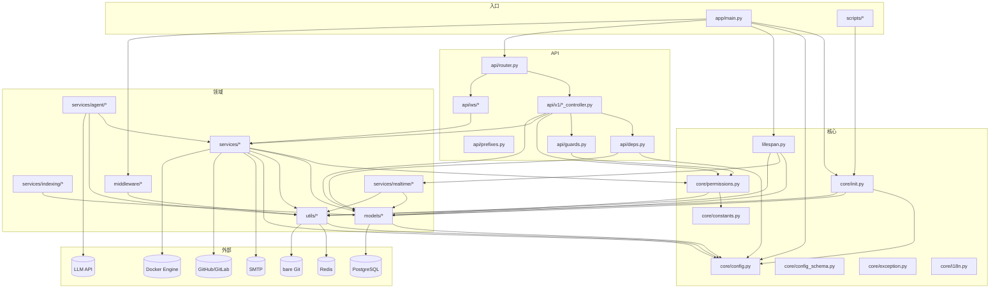

# 13 · 依赖关系

> 目标：明确模块之间的依赖方向、第三方库职责、外部服务边界与耦合风险。

---

## 1. 模块依赖总图

---

## 2. 分层依赖规则

层的次序（由上至下）：`api → services → middleware → core → models → utils`。
`core` 与 `models` 允许互相引用（策略需读实体、实体默认值需读常量），二者合看为「下层」。

下表与 `backend/tests/test_layer_boundary.py` 的 `LAYER_RULES` **一一对应**——
文档与守护测试是同一份规则的两个副本，改一处必须同步另一处。

| 层 | 允许依赖 | 违反示例（应避免） |
| --- | --- | --- |
| `api` | `api / services / middleware / core / models / utils` | controller 写复杂 SQL/事务 |
| `services` | `services / middleware / core / models / utils` | service import api |
| `middleware` | `middleware / core / models / utils` | middleware 调用 service |
| `core` | `core / models / utils` | `core/permissions` import controller |
| `models` | `models / core / utils` | 模型 import service |
| `utils` | `utils / core / models` | `utils/git_utils` import controller |

`app/` 根目录模块（`main.py`、`lifespan.py`）属装配层，可依赖任意层。

**规则由测试强制**：`tests/test_layer_boundary.py` 用 AST 扫描全部模块，
同时覆盖**模块级**与**函数体内**的 import——后者最容易被当作「合法的延迟导入」
而溜过去。该测试还带一条**延迟导入棘轮**：函数体内的 import 总数不得超过基线，
只收不放，防止债务悄悄反弹。

### 打破循环依赖的手法

1. **函数内延迟导入**：`repository_service` → `agent_service`、`search_service`。
2. **独立前缀模块**：`api/prefixes.py` 无项目依赖，controller 不 import `api/router.py`。
3. **子包 `__init__` 轻量**：`services/agent/__init__.py` 只导出注册表，不 import runtime/service。
4. **Protocol/注册表解耦**：`JobQueue`、`ModelProvider`、`ToolSpec`、`EmbeddingProvider`。
5. **事件/回调**：Git hooks 通过 HTTP 回调应用，而非共享代码。
6. **下移共享设施**：跨层共用的模块下沉到其**共同依赖层**——
   `ws_manager`/`ws_log_handler`/`prometheus_metrics` 落到 `utils`，
   `config_store` 落到 `core`，`vector_type` 落到 `models`，
   `notification_push` 落到 `services/realtime`；
   FastAPI 依赖工厂反向**上移**到 `api/guards.py`（它引用 `api.deps`，
   留在 `core` 会形成跨层环）。

---

## 3. 第三方依赖

### 3.1 运行时（`pyproject.toml`）

| 依赖 | 用途 | 主要使用点 |
| --- | --- | --- |
| `fastapi` | Web 框架/DI/OpenAPI | `app/main.py`、全部 controller |
| `uvicorn[standard]` | ASGI 服务器 | 生产 CMD |
| `gunicorn` | 备选进程管理（非 Windows） | `core/gunicorn.conf.py` |
| `pydantic` / `pydantic-settings` | 配置/请求校验 | `core/config.py`、controller 模型 |
| `toml` | 模板解析 | `config_store.example_seed_data` |
| `httpx` | 外部 HTTP | Agent/embedding/Webhook/OAuth/Docker API |
| `sqlalchemy>=2` | ORM/异步 | `models/*`、全部 service |
| `asyncpg` | 异步 PG 驱动 | `models/async_db.py` |
| `psycopg2` | 同步 PG 驱动 | `models/__init__.py`、脚本 |
| `alembic` | 迁移 | `alembic/`、`utils/init_database.py` |
| `greenlet` | SQLAlchemy async 运行时 | 间接 |
| `pygit2` | Git 对象操作 | `utils/git_utils.py`、browser/search/index |
| `passlib[bcrypt]` + `bcrypt==4.0.0` | 密码哈希 | `utils/password_utils.py` |
| `python-jose[cryptography]` | JWT | `services/token_service.py` |
| `cryptography` | AES-GCM 配置密钥 | `utils/config_crypto.py` |
| `redis` | 缓存/pubsub/位图 | `utils/redis_client.py`、token_state、presence、bus |
| `arq` | Agent 作业队列 | `services/agent/queue.py`、`worker.py` |
| `aiofiles` | 异步文件 IO | 上传/日志 |
| `aiosmtplib` | 邮件 | `utils/email_utils.py` |
| `jinja2` | 邮件模板 | `utils/email_utils.py` |
| `python-multipart` | 表单/上传 | 附件/头像/Release |
| `sentry-sdk[fastapi]` | 错误追踪 | `core/sentry.py` |
| `psutil` | 进程指标 | `services/process_metrics.py` |
| `tree-sitter` + 语法包 | 代码切块/符号 | `indexing/chunker.py` |

### 3.2 开发依赖

| 依赖 | 用途 |
| --- | --- |
| `pytest` / `pytest-asyncio` | 测试 |
| `respx` | httpx mock |
| `black` / `isort` / `flake8` | 格式化/静态检查 |

### 3.3 前端/网关（Node）

| 依赖 | 用途 |
| --- | --- |
| `@hocuspocus/server` | Yjs CRDT 服务 |
| `ioredis` | 跨副本 pub/sub + 快照 |
| （前端）Vite / React / pnpm 11 | `frontend/web`，网关镜像内构建 |

### 3.4 基础设施镜像

| 镜像 | 用途 |
| --- | --- |
| `pgvector/pgvector:pg16` | 数据库 + 向量 |
| `redis:7-alpine` | 缓存/队列 |
| `prom/prometheus` / `grafana/grafana` / `redis_exporter` | 监控 |
| `tecnativa/docker-socket-proxy` | 只读 Docker API |
| `openresty/openresty` | 网关/窄写代理 |

---

## 4. 外部服务边界

| 服务 | 协议 | 代码位置 | 失败策略 |
| --- | --- | --- | --- |
| PostgreSQL | `postgresql://` | `models/*` | 致命（启动失败/请求 500） |
| Redis | RESP | `utils/redis_client.py` | 降级（进程内/禁用功能） |
| Git 客户端 | HTTP/SSH | 网关 + git-cgi/sshd | 鉴权失败 401/403；hook 拒绝 |
| LLM provider | HTTPS OpenAI 兼容 | `agent/providers.py` | 未配置明确失败；请求失败落 failed |
| Embedding provider | HTTPS OpenAI 兼容 | `indexing/embeddings.py` | 自动退化为关键词 |
| GitHub/GitLab OAuth | HTTPS | `auth/oauth.py` | 登录失败提示 |
| SMTP | SMTP | `utils/email_utils.py` | 邮件失败仅告警，站内通知仍落库 |
| Docker Engine | HTTP（socket proxy） | `orchestration_service`、`docker_write_service` | 优雅降级 `available=false` |
| Grafana | HTTP | `grafana_service.py` | SSO 失败提示 |
| Sentry | HTTPS | `core/sentry.py` | DSN 空则禁用 |
| Webhook 目标 | HTTP(S) | `webhook_service.py` | 重试 + 投递历史；不阻断主流程 |

---

## 5. 子系统耦合矩阵

| 子系统 | 强依赖 | 弱依赖/事件 | 说明 |
| --- | --- | --- | --- |
| 仓库/Git | PG、repos 卷 | Redis（存在性缓存）、Webhook、Agent 触发器 | 物理仓与 DB 双真相 |
| PR/Issue/Release | PG、权限矩阵 | Git、通知、Webhook、搜索增量 | 内容域核心 |
| 搜索 | PG(pgvector)、Git | Embedding API、Redis 锁 | 无外部搜索集群 |
| Agent | PG、LLM、队列 | Git、搜索、Issue/PR 服务、WS、聊天 | 长任务独立 worker |
| 实时 WS | 进程内 manager | Redis bus、presence | Redis 缺失退化 |
| 协作 | collab 网关、PG、Git | Redis 快照、搜索增量 | 网关零业务 |
| 认证 | PG、JWT | Redis 撤销位图 | 无 Redis 用内存 |
| 配置 | PG、env | Redis（无） | 5s 版本轮询 |
| 运维/监控 | Docker API、Prometheus | Grafana、Sentry | 均可降级 |

---

## 6. 依赖风险与建议

| 风险 | 说明 | 建议 |
| --- | --- | --- |
| `pygit2`/libgit2 版本 | 同步 IO、线程安全依赖 libgit2 | 固定版本；所有调用走线程池；升级跑 Git 全量测试 |
| `bcrypt==4.0.0` 固定 | 与 passlib 兼容性 | 升级需验证哈希兼容 |
| PostgreSQL-only | 无 SQLite 兜底 | 开发/测试也需 PG；CI 提供 PG 服务 |
| tree-sitter 语法包 | 语言覆盖有限 | 未覆盖语言走正则/整文件，正确性不受影响 |
| Redis 可选但多处依赖 | 降级语义需保持 | 新功能必须定义无 Redis 行为 |
| 配置轮询 | 5s 窗口内多进程可能短暂不一致 | 热路径读取容忍；重启键明确提示 |
| Agent 外部 LLM | 网络/配额/模型差异 | 超时、预算、审批、配额多重保护 |
| 前端构建链 | 网关镜像依赖 `frontend/web` 的 pnpm 构建 | 构建失败时网关无法起镜像；前端改动需重建 gateway |
| SSH 脚本硬编码 DSN | 凭据泄漏风险 | 改为 env 注入；轮换凭据 |
| `git-shell-wrapper` eval | 命令注入面 | 改为白名单解析，不使用 eval |

---

## 7. 相关文件

- `backend/pyproject.toml`、`uv.lock`
- `backend/app/**`（依赖方向见上图）
- `backend/collab-gateway/package.json`
- `backend/docker-compose*.yml`
- `backend/tests/test_async_blocking_guard.py`（同步阻塞守卫）、`test_config_constants_wiring.py`（配置接线）
