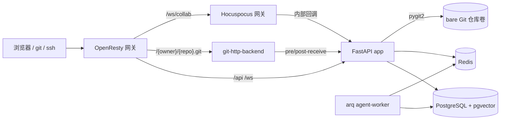

# Kustos Code Wiki

> 面向开发者的代码级知识库：项目定位、架构、模块职责、关键类与函数、依赖关系、运行与运维方式。
>
> 文档基于仓库当前代码（`backend/` 为主体，含 `frontend/web`）静态分析生成，所有结论均可在对应源码中复核。

---

## 1. 项目速览

**Kustos** 是一个 **Git-based collaborative development tool**（自托管 Git 协作开发平台），提供类 GitHub/GitLab 的仓库托管、代码浏览、Pull Request、Issue、Release、Webhook、实时聊天与协作编辑能力，并内置 AI Agent 与语义代码检索。

| 维度 | 内容 |
| --- | --- |
| 后端语言/框架 | Python 3.12 + FastAPI + Starlette |
| 数据访问 | SQLAlchemy 2.0（异步 `asyncpg` + 同步 `psycopg2`）|
| 数据库 | PostgreSQL（pgvector 扩展，唯一支持的数据库）|
| 缓存/消息 | Redis（可选，缺失时多处自动降级为进程内）|
| Git 引擎 | `pygit2`（libgit2）操作 bare 仓库；`git-http-backend` + `sshd` 提供协议接入 |
| 异步任务 | `arq`（Agent 作业 worker），无 Redis 时内联执行 |
| 协作编辑 | Node.js + Hocuspocus/Yjs 网关（`services/collab`）|
| 网关 | OpenResty/Nginx（同源反代、Git 鉴权子请求、Admin IP 白名单）|
| 可观测性 | 自研请求统计 + Prometheus `/metrics` + Grafana + Sentry |
| 前端 | `frontend/web`（Vite + React + TS），同时是 `gateway` 镜像的构建上下文 |
| 许可证 | MIT |

**代码规模（静态统计）**

| 指标 | 数量 |
| --- | --- |
| API 控制器 | 39 个 `*_controller.py` |
| HTTP/WS 路由声明 | 约 250+ 个 |
| 服务层文件 | 84 个（不含 `__init__.py`，按 11 个领域子包组织）|
| ORM 模型文件 | 38 个（不含 `base.py`/`async_db.py`/`uuid7.py` 等基础设施文件）|
| 迁移建表 | 53 张（`0001_initial` 51 张 + `0002_pr_issue_review_links` 2 张）|
| 测试文件 / 测试函数 | 188 个 / 2164 个 |

---

## 2. 文档导航

建议按「先全局后局部」的顺序阅读：

| 序号 | 文档 | 内容 |
| --- | --- | --- |
| 01 | [项目概览与功能全景](01-project-overview.md) | 产品定位、功能清单、技术栈、目录结构、术语表 |
| 02 | [整体架构](02-architecture.md) | 分层架构、请求链路、部署拓扑、核心数据流 |
| 03 | [启动流程与配置系统](03-bootstrap-and-config.md) | `create_app`、`init_app`、配置优先级、数据库迁移、生命周期 |
| 04 | [API 层](04-api-layer.md) | 路由注册、控制器清单、鉴权与权限矩阵、中间件、错误契约、WebSocket |
| 05 | [数据模型](05-data-model.md) | 53 张表的分组目录、字段、约束、关系与迁移策略 |
| 06 | [服务层](06-service-layer.md) | 服务清单、职责、关键函数、依赖规则与事务边界 |
| 07 | [Git 与仓库域](07-git-and-repository.md) | bare 仓库、分支/提交/标签、PR 合并、LFS、HTTP/SSH 接入与 hooks |
| 08 | [协作与实时系统](08-collaboration-realtime.md) | Hocuspocus 网关、Yjs 保存、WebSocket、房间/私聊、在线状态 |
| 09 | [搜索与索引](09-search-and-indexing.md) | 块级索引、tree-sitter 切分、embedding 混合检索、变更图索引 |
| 10 | [内置 Agent](10-agent-subsystem.md) | 作业状态机、工具循环、审批、arq worker、配额、触发器 |
| 11 | [部署与基础设施](11-infrastructure.md) | Compose 分层、容器拓扑、网关路由、监控、脚本 |
| 12 | [开发与运维指南](12-development-and-operations.md) | 本地启动、生产部署、备份升级、测试、排障 |
| 13 | [依赖关系](13-dependencies.md) | 模块内依赖、第三方依赖、外部服务、耦合矩阵 |

---

## 3. 30 秒建立心智模型

- **Git 数据平面**：裸仓库落在共享卷 `repos:/data/repositories`，路径规则为 `<repo_root>/<owner>/<repo>.git`。
- **业务控制面**：所有仓库元数据、PR/Issue/Release、权限、配置、索引、Agent 作业都在 PostgreSQL。
- **实时面**：WebSocket 由 FastAPI 管理，跨 worker 通过 Redis pub/sub 广播；协作文档由独立 Hocuspocus 网关承载。
- **配置面**：运行期配置来源为 **环境变量 > `app_config` 表 > 默认值**，`config.toml` 已弃用，`config.example.toml` 仅作播种模板。

---

## 4. 阅读约定

1. **路径**：文档中源码路径默认相对于仓库根目录，例如 `backend/app/main.py`。
2. **术语**：
   - **repo_id**：数据库 UUID 主键，API 的仓库域路由参数。
   - **repo_path**：逻辑路径 `owner/repo`（无 `.git` 后缀）。
   - **物理路径**：`<storage.repo_root>/<owner>/<repo>.git`。
   - **docKey**：协作文档标识 `repository_id:branch:path`。
3. **「降级」**：本项目大量组件在 Redis/DB/外部服务不可用时采用显式降级（进程内回退、Git tree 全扫、关键词检索等），文档会逐处标注。
4. **构建上下文**：`docker-compose.yml` 的 `gateway` 服务构建上下文为 `frontend/web`，镜像内用 Node 22 + pnpm 11 执行 `pnpm build`，宿主机无需 Node/pnpm。

---

## 5. 关键代码入口

| 入口 | 文件 |
| --- | --- |
| 应用工厂 / ASGI 实例 | `backend/app/main.py` |
| 初始化流程 | `backend/app/core/init.py` |
| 配置模型与单例 | `backend/app/core/config.py`、`backend/app/core/config_schema.py` |
| 路由总装配 | `backend/app/api/router.py`、`backend/app/api/prefixes.py` |
| 权限唯一裁决点 | `backend/app/core/permissions.py`（策略）+ `backend/app/api/guards.py`（依赖工厂） |
| 数据库会话 | `backend/app/models/async_db.py` |
| 生命周期 | `backend/app/lifespan.py` |
| Git 封装 | `backend/app/utils/git_utils.py` |
| 代码浏览 | `backend/app/services/repository/repository_browser_service.py` |
| 搜索 | `backend/app/services/search/search_service.py` |
| Agent 执行循环 | `backend/app/services/agent/runtime.py` |
| Agent 编排 | `backend/app/services/agent/agent_service.py` |
| 协作网关 | `services/collab/server.mjs` |
| 部署编排 | `docker-compose.yml`、`docker-compose.base.yml` |
| 不变量测试 | `backend/tests/` |
