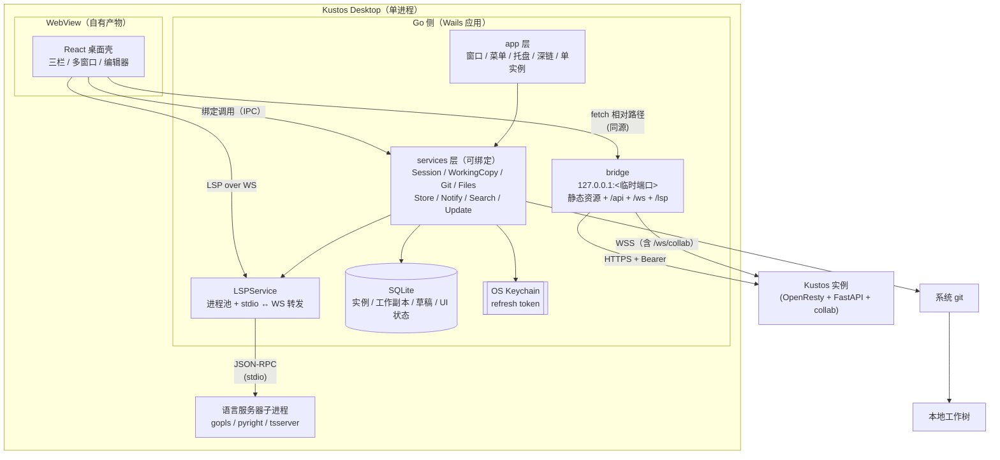
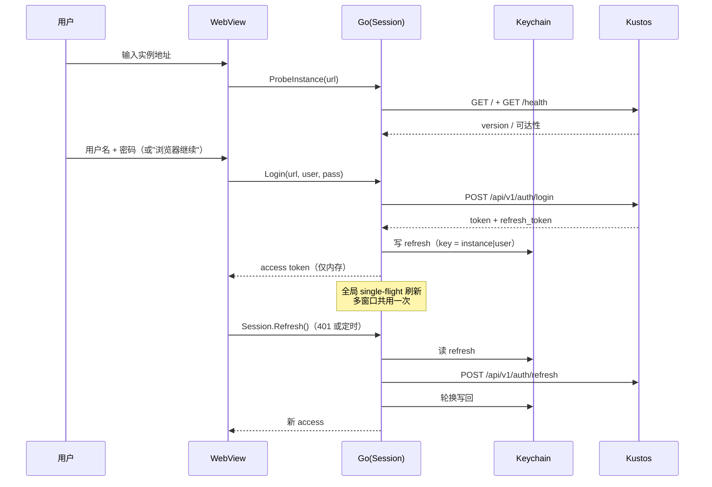
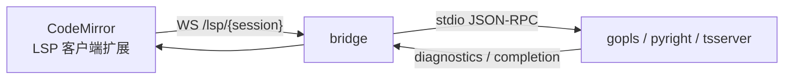

# Kustos 桌面端（Wails v3）设计

> 目标读者：负责 `frontend/desktop` 的前端 / Go 工程师。
> 本文回答两件事：**桌面端凭什么存在**，以及**它为什么不能是 Web 的复制品**。
>
> 本文只写设计意图与理由。**已经实现了什么、还差什么**见 [implementation-status.md](./implementation-status.md)——两份文档职责分开，免得设计文档随进度反复变脏。

---

## 0. 一页结论

**一句话定位**：Web 是"看与评"的协作面板，桌面端是"改、跑、收"的工作台。桌面端以**本地工作副本（working copy）**为中心组织信息，而不是以页面为中心。

**七条关键决策**

| # | 决策 | 理由 |
| --- | --- | --- |
| 1 | 前端产物**独立构建**，`//go:embed` 进二进制；不加载网关的 `dist` | 桌面端的导航、密度、窗格与 Web 不同，共用一份产物会被迫取交集 |
| 2 | 传输走 **loopback bridge**（Go 起的 127.0.0.1 临时端口），静态资源 + `/api` + `/ws` + `/lsp` 同一源 | 零服务端改造（无需给 `wails://` 加 CORS）、令牌不进 JS、WS 可全权控制、CI 能不开窗口做 e2e |
| 3 | 代码共享到**契约层**（OpenAPI 类型、请求函数、设计 token、基础组件），**不共享页面组合** | 页面组合恰恰是两端取舍不同的地方 |
| 4 | 交互范式用**三栏 master-detail + 多窗口**，取代 Web 的整页跳转 + 浮动 Dock | 桌面是常驻环境，用户待几小时；Web 是一次性访问 |
| 5 | 本地 Git 一律调**系统 `git`**，go-git 只做读 | hooks、LFS、签名、用户 config、submodule 全都是坑，重写一遍不值得 |
| 6 | 编辑器用 **CodeMirror 6**，做到"读改够用"；能力天花板由**本地 LSP** 抬 | 不做 VSCode，但代码读不动就没人用；LSP 是桌面端相对 Web 最大的单点增量（§7） |
| 7 | 一个文件同一时刻只有**一个真相来源**：磁盘 **xor** CRDT，模式互斥且切换有预检 | 双写必然漂移；在线协作不是"保存时合并"，是"进入前对齐"（§8） |

**三条红线的落实**

| 你的顾虑 | 反模式 | 本方案的做法 |
| --- | --- | --- |
| 不能只是个套壳浏览器 | `WebviewWindowOptions.URL = "https://kustos.example.com"` | 嵌入自有产物；Go 提供 10 类本地能力（§4），其中工作副本、语言服务器、系统通知、Keychain、多实例是 Web 物理上做不到的 |
| 不能照搬 Web 页面 | 把 `frontend/web/src` 整个搬过来改配色 | 只搬契约与 token；页面按桌面范式重写（§6），并明确列出"不要搬的东西"（§6.8） |
| 协作不能靠"打开网页才行" | 桌面只管本地，协作时让用户"去浏览器里改" | 同一份 CRDT 文档在同一编辑器里可切到协作模式，切换前做四步预检（§8） |

**一句话读懂 §7 与 §8**：编辑器是**一个组件、两种模式**；模式由"这个文件现在归谁"决定——归磁盘，就写盘、别人看不见；归 CRDT，就实时共享、保存落草稿分支。中间没有"两全"的选项，也不应该有。

---

## 1. 桌面端的存在理由

按"Web 做不到 / 做得很差"排序，只有这三层才值得开一个桌面项目：

### 1.1 本地事实

服务器上的仓库是 bare repo。**只有桌面端知道你的工作树长什么样**：未提交的改动、stash、本地分支、ahead/behind、冲突状态、哪个文件被 IDE 打开着。

这直接改变产品形态：PR 从"评审别人"变成"推之前先自检"，Issue 从"读描述"变成"读描述 + 跳到出错的那一行代码"。

而"跳到那一行"要真能跳、能改、能看诊断，靠的是**本地语言服务器**——服务端索引能做符号与引用，但做不了"你此刻这个 buffer 的类型错误"（§7）。

### 1.2 系统能力

| 能力 | 为什么浏览器给不了 |
| --- | --- |
| OS Keychain / Credential Manager | 浏览器只有 localStorage，XSS 即失守；Web 端现在就是这么取舍的（access 内存 + refresh localStorage） |
| 多实例并存 | 一个 origin = 一个实例。Kustos 是自托管产品，一个人同时连公司实例和个人实例是常态 |
| 原生通知 + 内联动作 | Web Notification 在 macOS/Windows 上不能带"批准/拒绝/稍后"按钮 |
| 多窗口 | 评审窗口放到第二块屏、聊天小窗常驻、命令面板全局唤起 |
| 深链 `kustos://` | 从 IM、终端、CI 日志直接打开某个 PR |
| 托盘 + 未读徽标 + 开机自启 | 关掉窗口不等于关掉应用 |
| 系统 git、终端、编辑器 | 沙箱里没有你的 `~/.gitconfig` 和 SSH key |
| **本地语言服务器** | 浏览器里没有进程能起 gopls / pyright / tsserver；补全、诊断、重命名、格式化全都没有 |
| **本地文件与进程** | 读写工作树、跑 `git`、调起你装好的编辑器，都需要文件系统权限 |

### 1.3 本地缓存与弱网

自托管实例常在内网/VPN 后面。桌面端可以做到：断网时仍能翻 Inbox、看缓存的 PR diff、写草稿；恢复后自动追平。这需要本地库，而浏览器存储不适合放"本机事实"（见 §5）。

**反过来说，桌面端不该做的事**（写进代码评审 checklist）：

- 不在本地重算权限（`app/core/permissions.py` 是唯一裁决点，桌面端只消费）
- 不在本地实现合并策略、保护规则、索引、Webhook
- 不在本地实现 CRDT 合并算法（网关与 Yjs 负责），桌面端只负责"何时进入、以谁为准"
- 不做"离线全功能"——离线只保证"读 + 写草稿/本地文件"

---

## 2. 架构

### 2.1 进程与层次



**职责边界（重要）**：Go 侧是**本地能力提供者**，不是第二个业务层。任何"这个用户能不能合并"的判断都必须回服务端。Go 里的代码只允许回答"本机是什么状态"。

### 2.2 传输为什么需要 bridge

WebView 加载 `wails://`（或 `http://wails.localhost`）后，向 `https://kustos.example.com/api/v1/...` 发请求属于**跨源**，需要服务端放行 `Access-Control-Allow-Origin: wails://...`。对一个自托管产品来说，这意味着**每一次部署都要改配置**——不可接受。

三种方案对比：

| 方案 | 服务端改造 | 令牌位置 | 流式/WS | 可测试性 | 结论 |
| --- | --- | --- | --- | --- | --- |
| A. WebView 直连远端 | 需 CORS 白名单 | JS 内存 | 原生可用 | 需开窗口 | 备选 |
| B. 全部走 Wails 绑定 | 无 | Go | 无 SSE、大 diff/上传要 base64 | 好 | 否 |
| C. **Loopback bridge** | **无** | **Go（refresh）/ JS 内存（access）** | 完整 | **Playwright 直连 bridge** | **采用** |

C 的关键收益不是"代理"，而是三点：

1. **前端代码与 Web 同构**：`fetch("/api/v1/...")`、`new WebSocket("ws://" + location.host + "/ws/...")` 原样可用，不需要给共享层加 transport 分支。
2. **令牌可以只在 Go 与内存里**：refresh token 永不出 Go；access token 由 Go 在登录/刷新时交给 JS（短生命周期，与 Web 同级风险）。
3. **CI 能不起窗口测**：`go test` 里起 bridge，Playwright 指过去，跑的是真实前端 + 真实代理链路。这是纯 Wails 方案拿不到的。

**Bridge 的安全约束**（缺一不可）：

- 只绑 `127.0.0.1`，端口由系统分配（`net.Listen("tcp", "127.0.0.1:0")`）
- 每次启动生成 32 字节 nonce，作为 HttpOnly + SameSite=Strict cookie 在首帧下发；非本 bridge 源的请求一律 401
- 不返回任何 CORS 头，等于只接受同源
- 只反代白名单前缀：`/api/v1/`、`/ws`、`/ws/collab`、`/lsp/`；其余 404
- **显式拒绝 `/api/app/`**：这是网关按 `KUSTOS_ADMIN_ALLOWED_SOURCES` 拦掉的实例管理面，桌面端不该有这条路（§6.3.1）
- `/lsp/{session}` 只接受本进程创建过的 session id（一次性、随机），不复用 HTTP 鉴权
- 反代时**强制覆写** `Origin`，防止上游把桌面端误判成 CSRF
- 进程退出即关闭监听

> 演进预留：若后端后续愿意支持 `wails://` 源，bridge 可退化为"仅 WS 代理"甚至消失。设计时把 bridge 放在接口后面（`Transport`），不要让它渗透到业务代码。

### 2.3 登录与刷新



三个细节值得写进实现说明：

- **刷新必须全局 single-flight**。后端 refresh 带重用检测，并发刷新会吊销整个 family。Web 端多标签页各刷一次就已经踩过这个坑；桌面端所有窗口共享一个 Go 进程，天然只需一把锁——这是桌面架构的便宜收益，别浪费。
- **每个窗口都要感知会话失效**。`onAuthLost` 不能只通知主窗口：Go 用 `app.Event.Emit("session:lost")` 广播，所有窗口各自决定（主窗口回登录页，评审窗口关闭）。
- **探活由 Go 直连上游**。`Probe(url)` 在自己的进程里请求 `GET /api/v1/client-compat` 与 `GET /health`，不走 bridge——bridge 的 `/` 是桌面端的 SPA，两者不能共用同一个路径。这也是为什么版本兼容判断放在 Go 而不是前端。兼容性声明是判据主依据，根路径只在没有该端点的老实例上兜底，且要求响应不是 HTML（真实部署的 `/` 返回前端 SPA）。

### 2.4 需要后端补的能力（按优先级）

| 优先级 | 能力 | 现状 | 影响 |
| --- | --- | --- | --- |
| P0 | refresh token 记 `device_name` / `client_id` | ✅ 已实现（`user_devices` + `/auth/sessions`） | 用户在"已登录设备"里能辨认会话并按设备定向吊销 |
| P1 | `GET /api/v1/repositories/{id}/collab/active` | ✅ 已实现（网关内部端点 + app 聚合多副本） | 桌面的"协作感知"（文件树 live 圆点、进入前预警）所需数据已就绪，界面侧待接入（§8.4） |
| P1 | 设备码 / PKCE 浏览器授权 | ✅ 已实现（PKCE 授权码流 `/auth/pkce/*`） | 密码型 SSO、2FA 环境不必再开浏览器输密码，体验连贯 |
| P2 | 幂等键（`Idempotency-Key`） | ✅ 已实现（`idempotency_records`，评论/Issue 已接入） | 离线 outbox 可做"自动补发"，不会产生重复评论/Issue |
| P3 | `GET /api/v1/client-compat` | ✅ 已实现（公开面，声明 api_version/api_min/features） | 桌面端按能力开关降级，不再靠 version 猜 |

---

## 3. 代码组织

### 3.1 目录

```text
frontend/
├── packages/
│   ├── api/                  # OpenAPI 类型 + 请求函数 + Session 接口（不含 hooks）
│   ├── design/               # Tailwind v4 token、字体、基础动效
│   ├── ui/                   # 无业务的展示组件（button/dialog/list/splitter/kbd）
│   ├── editor/               # CodeMirror 扩展组合：base / localFile / lsp / yCollab / diffGutter
│   └── domain/               # 纯函数：diff 解析、markdown、相对时间、i18n 词条
├── web/                      # 现状，逐步改为消费 packages
└── desktop/
    ├── go/                   # Wails 应用（module github.com/<org>/kustos-desktop）
    │   ├── main.go
    │   ├── internal/app/     # 生命周期、窗口、菜单、托盘、深链
    │   ├── internal/bridge/  # loopback server + 反向代理 + /lsp 转发
    │   ├── internal/services/# 可绑定服务（§4）
    │   ├── internal/lsp/     # 语言服务器进程池、帧解析、能力探测
    │   ├── internal/store/   # SQLite + 迁移
    │   ├── internal/platform/# 各 OS 差异（badge / protocol / keychain）
    │   └── bindings/         # wails3 生成，提交进仓库
    ├── web/                  # Vite + React 桌面壳
    │   ├── src/shell/        # 窗口外壳（titlebar / rail / list / detail / statusbar）
    │   ├── src/surfaces/     # Inbox / WorkingCopy / Code / PR / Issues / Chat / Agent
    │   ├── src/windows/      # 评审窗、聊天小窗、命令面板窗
    │   ├── src/bindings/     # 生成的 TS 绑定（勿手改）
    │   └── src/lib/          # 桌面侧适配（deep link 路由、托盘事件、窗口控制、文档模式机）
    ├── build/                # build/config.yml、图标、NSIS / dmg / desktop 模板
    └── wails.json
```

### 3.2 共享什么、不共享什么

| 层 | 共享 | 说明 |
| --- | --- | --- |
| OpenAPI 类型 `schema.d.ts` | ✅ | 单一生成源，`packages/api` 里跑一次，两端消费 |
| 请求函数（`features/*/api.ts`） | ✅ | 纯函数，无 React 依赖 |
| TanStack Query hooks | ⚠️ 部分 | 能共享 `queryKey` 与 `queryFn`；`staleTime`、持久化策略两端不同 |
| 设计 token（ink/amber/sage…） | ✅ | 品牌一致，但**桌面端字号/间距 token 另有一套**（§6.4） |
| 基础展示组件 | ✅ 逐步 | 只搬 `button`、`dialog`、`list`、`tooltip` 这类无布局假设的 |
| **编辑器扩展**（`packages/editor`） | ✅ 基线层 | 主题、语言、多光标、搜索共享；`localFile` / `lsp` / `diffGutter` 只在桌面端挂 |
| 页面组合 / 布局 | ❌ | `app-shell.tsx`、`sidebar.tsx`、`topbar.tsx`、`repo-tabs.tsx` 一律不共享 |
| 悬浮 Dock 面板范式 | ❌ | Web 为窄视口做的覆盖式取舍，桌面端不需要（§6.8） |

**迁移顺序**（避免一次性大重构）：先抽 `packages/api`（本来就是生成物，风险最低）→ 再抽 `packages/design` 的 token → 基础组件最后动。`frontend/web` 在每个阶段都应保持可构建，用 `pnpm --filter` 保证两端同时通过类型检查。

### 3.3 生成物管理

- `wails3 generate bindings` 的输出（`bindings/` + `src/bindings/`）**提交进仓库**，并在 CI 里加一步"重新生成后 git diff 必须为空"，否则绑定与 Go 服务会悄悄漂移。
- OpenAPI 类型同理：`pnpm api:generate` 后 diff 为空。
- 两套生成物各自有 owner：绑定归 Go，类型归后端契约。别让前端手写任何一个。

---

## 4. Go 侧服务

绑定面按"用户能感知的本地能力"切，不按后端领域切。每个服务都应能在**不开窗口**的情况下被 Go 单测覆盖。

| 服务 | 关键方法（示意） | 说明 |
| --- | --- | --- |
| `SessionService` | `Probe(url)`、`Login`、`Logout`、`Refresh`、`Profiles`、`Switch` | 令牌与实例档案；refresh 全局串行 |
| `WorkingCopyService` | `Add(path)`、`List`、`Status(id)`、`Stage(id, paths\|hunks)`、`Commit`、`Fetch`、`Push`、`Branches`、`Checkout` | 本地 Git 的唯一入口 |
| `DiffService` | `FileDiff(id, path, staged)`、`Blob(id, rev, path)` | 未提交 diff 不走网络 |
| `FileService` | `PickFolder`、`Reveal`、`OpenInEditor`、`PasteImage`、`ReadText`、`WriteText(expectedMtime)` | 系统对话框与编辑器集成；写盘带冲突检测 |
| `LSPService` | `Ensure(root, language)`、`Sessions()`、`Restart(id)`、`Stop(id)`、`InstallHint(language)`、`SetTrust(root, ok)` | 语言服务器进程池 + 能力探测（§7） |
| `StoreService` | `GetUI/SetUI`、`Drafts`、`Outbox`、`OpenBuffers` | SQLite 读写，schema 版本化 |
| `NotifyService` | `Notify(kind, title, body, actions)`、`SetBadge`、`TrayMenu` | 通知点击回调 → `app.Event.Emit` |
| `SearchService` | `IndexLocal(repoId)`、`Query(q)` | 本地 FTS5，只索引工作树与缓存标题 |
| `UpdateService` | `Check`、`Download`、`Apply`、`SetChannel` | 支持"企业禁用自动更新" |
| `ShellService` | `OpenExternal(url)`、`Copy(text)`、`Window(action)` | 外部链接一律走系统浏览器 |

约定：

- 绑定方法的入参/出参用**扁平 DTO**，不要直接暴露 internal 结构体；类型会原样变成 TS 定义，一旦嵌套内部字段就会被前端依赖住。
- 所有可能超过 200ms 的方法都接受 `context`，并支持取消（拉取、克隆、索引）。
- 所有会写磁盘的方法都要在文档里写清"失败了会留下什么"。

---

## 5. 本地数据

**一条规则**：**前端缓存 = 服务端镜像；SQLite = 本机事实**。两者不混。

| 存放位置 | 内容 | 理由 |
| --- | --- | --- |
| IndexedDB（`persistQueryClient`） | HTTP 响应缓存、Inbox 快照、PR/Issue 列表与详情 | 跨窗口同源共享；TanStack Query 原生支持；清缓存不影响本机事实 |
| SQLite（Go） | 实例档案、工作副本、草稿、UI 状态（窗口尺寸/栏宽/排序）、本地索引 | Go 需要直接读写；要事务；要迁移 |
| Keychain | refresh token、TLS 指纹（自签场景） | 系统级加密 |

SQLite 草案（`internal/store/migrations`）：

```sql
instances(id TEXT PK, base_url TEXT, name TEXT, version TEXT, tls_pin TEXT, created_at INT)
working_copies(id TEXT PK, instance_id TEXT, repo_id INT, path TEXT UNIQUE,
               branch TEXT, ahead INT, behind INT, dirty INT, last_scan_at INT)
workspace_trust(path TEXT PK, trusted INT, decided_at INT)
open_buffers(id TEXT PK, working_copy_id TEXT, path TEXT, mode TEXT,
             cursor_json TEXT, dirty INT, updated_at INT)
buffer_recovery(id TEXT PK, working_copy_id TEXT, path TEXT,
                content TEXT, base_mtime INT, saved_at INT)
drafts(id TEXT PK, instance_id TEXT, kind TEXT, target_id TEXT, body TEXT, updated_at INT)
outbox(id TEXT PK, instance_id TEXT, method TEXT, path TEXT, body TEXT, state TEXT, created_at INT)
ui_state(key TEXT PK, value TEXT)
search_doc(rowid INTEGER PK, instance_id TEXT, repo_id INT, kind TEXT, title TEXT, body TEXT)
```

`buffer_recovery` 只存**未保存**的本地 buffer：崩溃或强杀后重开，能恢复"改了但没存"的内容，并在保存前让用户确认磁盘是否已被外部修改（比对 `base_mtime`）。这是编辑器类应用必须有的兜底，Web 端没有对应问题，容易漏。

失效策略：

- 所有缓存行带 `instance_id`；切实例即切命名空间，**不要**用一个全局缓存再过滤。
- 登出时清该实例的 HTTP 缓存与 drafts，保留工作副本记录（用户不期望"登出把 clone 记录删了"）。
- `schema_migrations` 版本不匹配时：能迁移则迁移，不能则**只删缓存表**（`search_doc`、HTTP 缓存），绝不删 `working_copies`。

---

## 6. 界面：从 Web 范式到桌面范式

这一节是本文的核心。原则一句话：**Web 在"一次访问"的假设下做取舍；桌面在"常驻几小时"的假设下重做取舍。**

### 6.1 范式对照

| 维度 | Web 现状 | 桌面端 | 为什么 |
| --- | --- | --- | --- |
| 导航 | 整页路由跳转 + 侧栏 | 三栏常驻，选中即换右侧内容 | 桌面用户在一小时内会在 PR/代码/Issue 之间来回几十次，整页跳转每次都要重建滚动位置与查询 |
| 状态载体 | URL 是唯一真相 | 选择状态 store 为主，URL 仅作深链入口 | 多窗口下"地址栏"没有意义，窗口本身就是上下文 |
| 上下文档 | 右缘浮动 Dock，覆盖画布 | 内联可拖拽侧栏，宽度记住 | Dock 是为 900px 视口妥协的；桌面上 1440px 起步，覆盖画布反而丢信息 |
| 首屏 | 路由级 lazy + 整屏 fallback | 骨架只给首次冷启动，之后 stale-while-revalidate | 切换慢 300ms 在网页能忍，在桌面像卡 |
| 空状态 | 品牌化插画 + 说明 | 直接给可执行命令（`⌘N`、拖文件夹进来） | 桌面用户要的是动作，不是介绍 |
| 密度 | 44–56px 行高、舒适间距 | 28–32px 行高、13px 正文 | 长期驻留 + 大屏，信息密度优先 |
| 装饰 | 全屏径向渐变 + 噪点层 | 只在标题栏与空态保留 | 固定全屏 `feTurbulence` 在 WebKitGTK 上是真金白银的掉帧 |
| 通知 | 站内 + WS 红点 | 系统通知带动作按钮 + 托盘徽标 | 窗口可能根本不在前台 |
| 错误 | toast | 就地状态条 + 可重试动作，跨窗口一致；一次性失败（提交/推送）用居中对话框 | 常驻应用不该用一次性提示掩盖持续故障；而一次性失败要的是把原始输出读清楚 |

### 6.2 主窗口

```text
┌───────────────────────────────────────────────────────────────────────────┐
│ ◐ kustos   acme/atlas ▾   ⎇ feature/x ↑2 ↓0    ⌘K 搜索…      ● 在线 46ms │ 38px 自定义标题栏
├──────┬──────────────────────────┬─────────────────────────────────────────┤
│  ⌂   │  待我决策            12  │  PR #142  feat: 实时协作光标             │
│  ⌥   │  ─────────────────────── │  ─────────────────────────────────────  │
│  {}  │  ▸ #142 Requested you  ● │  描述 / 时间线 / diff …                  │
│  ⇄   │    atlas · 2h            │                                          │
│  ✉   │  ▸ A-1042 等待审批     ● │                        ┌──────────────┐│
│  ✦   │    atlas · 40m           │                        │ 评审人/检查   ││
│      │  ▸ @you in #atlas        │                        │ 可拖拽侧栏    ││
│      │                          │                        └──────────────┘│
│  ⚙   │  ── 我发起的 ──          │                                          │
│  (◉) │  ▸ #139 Waiting review   │                                          │
├──────┴──────────────────────────┴─────────────────────────────────────────┤
│ ⎇ feature/x 干净 · 2 ahead  │  后台：索引 3/7  │  待发 1  │  同步于 12s  │ 24px 状态条
└───────────────────────────────────────────────────────────────────────────┘
```

尺寸与交互：

- 默认 `1440×900`，最小 `1100×700`；窗口尺寸/位置/最大化状态写 `ui_state`，按窗口类型分别记。
- 左轨 56px 固定（图标 + 底部实例切换）；列表栏 `260–420px` 可拖，默认 320；右侧侧栏 `240–360px` 可拖、可折叠。
- 分割线用 1px `edge` 色，热区 6px；拖拽时显示 2px 琥珀预览线。
- 窄于 `1100px` 时侧栏转为覆盖式（此时才借用 Web 的取舍），列表栏可折叠为抽屉。
- 底部状态条是**桌面独有**：它承担"远端状态 vs 本机状态"的差异表达，Web 没有这个概念所以不需要。

### 6.3 Surface 清单

| Surface | 默认动作 | 主键 | 数据源 | 桌面专有 |
| --- | --- | --- | --- | --- |
| **Inbox**（首页） | 分段：待我决策 / 我发起的 / 动态 | `a` 批准 `r` 拒绝 `s` 稍后 `↵` 打开 | `/api/v1/notifications` + PR review 请求 + agent 待审批 | 批量多选、单键处理、系统通知回跳定位 |
| **Working Copy** | 仓库列表 → 变更列表 → 逐 hunk 暂存 → 提交 | `space` 暂存 `c` 提交 `p` push | 系统 git（本地） | ✅ 全新，Web 无对应面 |
| **Code** | 文件树 + 标签页 + 编辑器 + 检查器（符号/诊断/协作者） | `⌘P` 跳文件 `⌘S` 保存 `F12` 定义 `⌥F12` 引用 | 本地工作树（+ 服务端 blob 兜底） | 可编辑、LSP 补全/诊断/重命名、diff 行标、blame、协作者光标（§7、§8） |
| **PR** | 列表 + 评审窗 | `j/k` 走 hunk `c` 行内评论 `⇧↵` 提交评审 | `/repositories/{id}/pulls/...` | 独立窗口、草稿本地保存、评审队列 |
| **Issues** | 列表 + 详情 + 字段侧栏 | `s` 状态 `l` 标签 `a` 指派 | `/issues/...` | 拖拽附件、从本地文件建 Issue |
| **Chat** | 频道树 + 消息流 | `⌘⇧Space` 快速回复 | `/ws` + `/room` | 常驻小窗、拖文件、截图粘贴 |
| **Agent** | 运行列表 + 轨迹 + 审批 | `a/r` 审批 | `/agent/jobs` + WS | 原生审批弹窗带 diff 预览、"拉成本地分支复现" |

七个 surface，没有第八个。管理面不是"暂时不做"，是**结构上不该有**（§6.3.1）。

#### 6.3.1 为什么桌面端没有管理面

Kustos 的实例级能力是**双层门禁**：网关先按 `KUSTOS_ADMIN_ALLOWED_SOURCES` 对 `^~ /api/app/` 做来源白名单（留空即全部拒绝），后端再由 `get_current_admin_user` 校验 `User.is_admin`。

桌面端跑在终端用户的机器上，出口地址不可控，**过不了第一层**——而且这层是运维有意设的边界，不是待修的缺陷。所以：

- 桌面端**不请求任何 `/api/app/*`**，UI 里也不出现 `is_admin` 分支。不做"按钮在、点了 403"的死路，也不做"管理员才看得到的半截控制台"
- 管理员仍然用浏览器，在受信网络里访问网关。桌面端不是运维工具
- bridge 的白名单因此收紧一层：`/api/app/` 直接 404，比让它打到上游换一个 403 更早、更清楚。要报"没有权限"时也说得准——不是你的权限不够，是这个客户端不提供这条路径
- 产品定位上也自洽：桌面端是**分发给团队成员的客户端**，不是随包附赠的运维台。把管理面塞进分发包，等于把"谁能操作实例"的问题从网络位置降级成"谁装了哪个包"

> 如果将来真要在桌面端放实例信息，只允许读 `/health` 与 `GET /`（两者都是无鉴权的公开面），且只显示"实例名 + 版本 + 可达性"，不显示任何组件、配置、用户或日志。

### 6.4 密度与视觉 token

品牌不变，尺度变。

| Token | Web | Desktop |
| --- | --- | --- |
| 正文字号 | 14 / 15 | 13 |
| 行高（列表） | 44–56 | 28–32 |
| 圆角 | 12–16 | 8–10 |
| 间距步长 | 4 | 2（更细的控制） |
| 内容最大宽 | `68–78ch` | 不变（长文仍限宽，否则一行 200 字符） |
| 展示字体 Fraunces | 页面标题 | **仅**引导页、空态、关于窗口 |
| 阴影 | 面板浮起 | 仅弹层 / 菜单 / 通知 |

理由：Fraunces 在密集表格里读起来像装饰；桌面端的"温度"应该来自间距节奏和琥珀色的克制使用，而不是标题字号。

### 6.5 多窗口

| 窗口 | 触发 | 记忆 | 生命周期 |
| --- | --- | --- | --- |
| 主窗口 | 启动 / 托盘 | 尺寸、位置、上次 surface 与选中项 | 关闭 = 隐藏到托盘（可在设置里改为退出） |
| 评审窗 | PR 里 `⌘⇧↵` 或列表右键"在新窗口评审" | 每 PR 独立尺寸位置 | 随 PR 关闭；重启后恢复上次打开的评审窗 |
| 聊天小窗 | 全局快捷键 | 固定 380×560，靠边吸附 | 失焦不关，`Esc` 关 |
| 命令面板窗 | 全局快捷键（应用不在前台也响应） | 屏幕居中，跟随鼠标所在屏 | 失焦即隐 |
| Agent 监视窗 | 长任务"在窗口打开" | 尺寸位置 | 可最小化到托盘 |

实现要点：`app.Window.NewWithOptions` 每个窗口给 `Name`，用 `app.Window.GetByName` 复用而不是重复创建；窗口级事件用 `window.OnWindowEvent`，跨窗口消息一律走 `app.Event`。

### 6.6 原生 chrome

**菜单树**（macOS 菜单栏 / Windows 窗口菜单）：

```text
Kustos   关于 / 设置… / 语言服务器… / 检查更新 / 退出
文件      新建 Issue ⌘N / 新建 PR / 添加工作副本… / 关闭窗口 ⌘W
编辑      撤销 / 重做 / 剪切 / 复制 / 粘贴 / 全选 / 查找 ⌘F
          ── 保存 ⌘S（语义随文档模式变）/ 格式化 ⇧⌥F / 重命名 F2 / 跳转定义 F12
视图      命令面板 ⌘K / 切换侧栏 ⌘⌥S / 切换列表栏 ⌘⌥L / 紧凑模式 / 重新加载 ⌘R
仓库      Fetch ⌘⇧F / Pull / Push ⌘⇧P / 提交… / 新建分支 / 在浏览器打开
          ── 进入协作… / 退出协作 / 保存协作草稿
转到      Inbox ⌘1 / 工作副本 ⌘2 / 代码 ⌘3 / PR ⌘4 / Issue ⌘5 / 聊天 ⌘6 / Agent ⌘7
窗口      最小化 / 缩放 / 下一条目 ⌘⇧] / 评审窗列表
帮助      快捷键速查 / 文档 / 反馈
```

菜单项要**随焦点窗口的上下文启用/禁用**（没有工作副本时"仓库"菜单置灰；未进入协作时"退出协作"置灰），这是桌面用户判断"我现在在哪个上下文"的主要线索。

**托盘菜单**：待我决策（数）· Agent 待审批（数）· 最近仓库（5 个）· 暂停通知 · 开机自启 · 打开 Kustos · 退出。

**右键菜单**：列表行（打开 / 在新窗口打开 / 复制链接 / 标记已读 / checkout 到本地）、代码行（复制行 / 复制 permalink / 在编辑器打开 / 在此处进入协作 / Ask Kustos）、文件树（在编辑器打开 / 在此文件中查找 / 进入协作 / 复制相对路径）、消息（回复 / 引用 / 复制链接）。

**键盘**：`⌘K` 命令面板、`⌘1..7` 切 surface、`⌘P` 跳文件、`⌘S` 保存、`j/k` 列表、`⌘↵` 发送、`⌘⇧↵` 提交评审、`F6` 在"左轨 / 列表 / 详情 / 侧栏"之间切焦点（替代 Web 的"跳到主内容"）。注意与 WebView 默认键冲突：`⌘R`、`⌘W`、`⌘S`（会唤起浏览器"另存为"）都要显式接管。

### 6.7 状态设计

常驻应用最容易被忽视的是"持续性状态"，它们不该用 toast：

| 状态 | 呈现 | 位置 |
| --- | --- | --- |
| 在线 / 弱网 / 离线 | 标题栏右侧圆点 + 文字（`在线 46ms` / `弱网` / `离线 · 3 分钟前`） | 常驻 |
| 文档模式 | 编辑器头部徽标：`本地` / `协作 · 3 人` / `只读` | 编辑器内 |
| 协作连接 | 离线缓冲时显示 `离线协作 · 12 条待同步`，不报错 | 编辑器头部 |
| LSP | 状态条 `gopls 就绪` / `语言服务器未安装` / `崩溃，已重启 1 次` | 常驻 |
| 后台任务 | 状态条 `索引 3/7`，点开是任务列表 | 常驻 |
| 待发（草稿/未同步） | 状态条 `待发 1`，琥珀点 | 常驻 |
| 长任务（clone/push） | 状态条进度 + 可展开日志 | 常驻 |
| 操作失败（提交 / 推送） | 居中对话框，git 原始输出可滚动、可复制 | 挡在主操作上，关闭即消失 |
| 会话失效 | 顶部横幅 `会话已失效，重新登录`，保留当前草稿与未保存 buffer | 全局一次 |
| 服务器版本过旧 | 阻断式全屏 + 升级说明 | 启动时一次 |

### 6.8 明确不要搬的东西

逐条对应现有 Web 代码，避免"搬着搬着就变成复制品"：

| Web 里的东西 | 桌面端处理 |
| --- | --- |
| `components/layout/app-shell.tsx` | 重写为 `shell/`：标题栏 + 左轨 + 列表 + 详情 + 状态条 |
| `components/layout/sidebar.tsx` | 左轨只放 7 个 surface 图标 + 实例切换，不再承载"三层导航" |
| `components/layout/topbar.tsx` | 拆散：仓库/分支选择进标题栏，`New` 进原生菜单与 `⌘N` |
| `components/layout/repo-tabs.tsx` | 变成列表栏顶部的分段控件（不换页） |
| `components/editor/code-view.tsx`（只读查看器） | 换成 `packages/editor`：可编辑 + LSP + 模式徽标（§7） |
| `collab-editor.tsx`（只有在线一种模式） | 重写为受控组件：模式由 `EditorSession` 决定，`yCollab` 变成可挂载扩展（§8） |
| 顶栏通知铃铛 | 托盘 + 系统通知；应用内只保留 Inbox surface |
| 右缘浮动 Dock | 可拖拽内联侧栏 |
| 全屏氛围渐变 + 噪点 | 仅标题栏 + 空态 |
| `pages/placeholder-page.tsx` 式空态 | 可执行命令提示 |
| 整页 `PageFallback` | 首次冷启动骨架 + 后续局部 loading |

### 6.9 一个具体对比：PR 评审

| | Web（现状） | 桌面端 |
| --- | --- | --- |
| 容器 | 单页，diff 与讨论上下堆叠 | 独立窗口，左右 55/45 分栏，可拖 |
| 文件切换 | 页内锚点 / 下拉 | 左栏文件树（树上带已读/已评标记），`j/k` 走 hunk，`⌘⇧[` 走文件 |
| 评论 | 提交即发 | 先在本地草稿箱，窗口底部显示 `3 条待提交`，`⌘⇧↵` 一次性提交评审 |
| 上下文 | 切走就丢滚动位置 | 每 PR 记住滚动与折叠状态，重开窗口原位恢复 |
| 与本地对比 | 无 | 若该分支已 clone：显示"本地分支已含这 2 个提交" |
| 关闭 | 浏览器返回 | `⌘W` 关窗，主窗口列表里的未读状态同步清除 |

---

## 7. 编辑器与本地 LSP

### 7.1 定位：三层能力，天花板写在纸上

桌面端需要的是**"读得动、改得动"**，不是 IDE。把能力分三层写死，避免范围失控：

| 层 | 内容 | 是否做 |
| --- | --- | --- |
| 基线 | 语法高亮、括号匹配、多光标、查找替换、折叠、行号、缩进、脏标记、diff 行标、blame | ✅ 必须 |
| 智能 | LSP 补全、hover 类型、内联诊断、跳转定义/引用、重命名、代码动作、格式化、文档符号 | ✅ 本设计范围 |
| IDE | 调试器（DAP）、任务/运行配置、扩展市场、内置终端、Notebook、多根工作区 | ❌ 永不做 |

重度改造仍然交给用户自己的编辑器：`⌘⇧O` 在系统编辑器打开（VS Code / JetBrains / `$EDITOR`）。这不是逃避——桌面端继续监听文件变化，改完回来 git 状态和 diff 都在。**编辑器是"就地小改 + 理解代码"，不是"长时间开发"**，这条边界决定了后面所有取舍。

### 7.2 复用 Web 的 CodeMirror 栈

Web 端已经有一套：`@codemirror/*`、`y-codemirror.next`、`components/editor/kustos-theme.ts`、`language.ts`、`collab-editor.tsx`。桌面端**用同一套**，只是多挂三个桌面专有扩展：

```text
@kustos/editor
├── base       主题 / 键位 / 搜索 / 折叠（共享）
├── localFile  磁盘读写、mtime 冲突检测、脏状态
├── lsp        补全 / 诊断 / 跳转 / 重命名 / 格式化
├── yCollab    CRDT 绑定 + 远端光标（协作模式才挂）
└── diffGutter 相对 HEAD 的增删标记 + blame
```

不用 Monaco：包体与 worker 成本高、与 `y-codemirror` 生态不兼容，而且会迫使 Web 与桌面分叉出两套编辑体验——这正是要避免的。

### 7.3 LSP 接入

**进程归 Go，协议走 WebSocket。**



理由：CodeMirror 生态的 LSP 客户端都吃 WebSocket transport；走绑定的话每个补全请求一次 IPC 往返，输入延迟会肉眼可见。bridge 里做 `ws ↔ stdio` 双向转发，注意 LSP 是**带 `Content-Length` 头的帧协议，不是行协议**，按帧解析，别用 `bufio.Scanner`。

生命周期：

- `Ensure(root, language)` → spawn → `initialize` / `initialized` → 客户端 `didOpen`
- 空闲 10 分钟 `shutdown` + 回收进程；崩溃按 1s / 2s / 4s 退避重启，3 次后放弃并提示（不要让一个语言服务器崩掉整个应用）
- 并发上限 3 个服务器（gopls 单实例常吃 1GB+），超限时提示"先关掉其他仓库的编辑器"
- 每个服务器绑定一个 workspace root，不共享进程（LSP 的 rootUri 语义就是单根）

语言服务器探测（marker 文件 → 命令 → 安装提示）：

| 语言 | marker | 服务器 | 缺失时 |
| --- | --- | --- | --- |
| TypeScript / JS | `package.json`、`tsconfig.json` | `typescript-language-server` | 提示 `npm i -g`，并回落为仅高亮 |
| Python | `pyproject.toml`、`setup.py` | `pyright` / `basedpyright` | 同上 |
| Go | `go.mod` | `gopls` | `go install golang.org/x/tools/gopls@latest` |
| Rust | `Cargo.toml` | `rust-analyzer` | 官方文档链接 |
| JSON / YAML / CSS / Markdown | `*.json` 等 | `vscode-langservers-extracted` | 静默回落 |

**不静默下载二进制**。自托管用户在企业网里，静默下载大概率失败且不可审计；给命令、给"复制安装命令"按钮即可，装好后在设置里点"重新探测"。

### 7.4 文档同步的四个坑

1. **版本号必须单调递增**。LSP 对 `textDocument/didChange` 的 `version` 有强约束，乱序会被服务端拒绝并静默失步。
2. **协作模式下变更来源是 Y.Doc**。远端每敲一个字符都会触发 update，直接 `didChange(全文)` 会让补全抖动、CPU 飙升。做法：50–100ms 去抖，把当前全文与上次发送的全文做最小 diff，只发变更区间。
3. **切模式必须 `didClose` + `didOpen`**。不能中途换 URI 或换内容来源，否则服务端的文档状态会错乱。
4. **无工作副本时没有 `file://`**。纯在线浏览的文件只能用虚拟 URI（如 `kustos://repo/branch/path`），多数服务器不认——此时直接禁用 LSP，只留高亮，不要假装能跳转。

### 7.5 workspace trust（必须做）

语言服务器会**执行工作区里的代码**：pyright 会解析项目导入、tsserver 会加载 `package.json`、gopls 会跑 `go list`。等价于"运行这个仓库里的东西"。

- 首次打开一个工作副本时弹一次确认：`此工作副本来自 acme/atlas，允许运行本地语言服务器与项目配置？`
- 未信任：编辑器**只读** + 高亮，不启 LSP
- 信任记在 SQLite `workspace_trust`；路径变化、切仓库、远端 origin 变化都要重新确认

### 7.6 降级矩阵

| 场景 | 高亮 | LSP | `⌘S` |
| --- | --- | --- | --- |
| 工作副本 + 已信任 + 服务器已装 | ✅ | ✅ | 写磁盘 |
| 工作副本 + 未装服务器 | ✅ | ❌（给安装命令） | 写磁盘 |
| 工作副本 + 未信任 | ✅ | ❌ | 只读 |
| 无工作副本（纯在线浏览） | ✅ | ❌ | 只读 |
| 协作模式 + 有工作副本 | ✅ | ✅（内存文档） | 保存到 draft 分支 |

---

## 8. 本地状态 ↔ 在线协作

这是桌面端**唯一没有现成答案**的地方，值得单独设计。

Web 天然在线：打开页面即连网关，编辑器从头就是 CRDT。桌面天然本地：文件躺在磁盘上，`git status` 才是真相。两者相遇时，一个文件可能同时存在于**三个位置**：

1. 磁盘上的工作树（可能 dirty，可能在别的分支）
2. Git 分支 head（工作分支，或协作草稿分支 `collab/draft-{branch}`）
3. 活跃的 CRDT 会话（docKey = `repository_id:branch:path`，可能有别人正在改）

### 8.1 铁律：一个文件一个真相

| 模式 | buffer 绑谁 | `⌘S` | 别人看得到吗 | LSP |
| --- | --- | --- | --- | --- |
| **本地** `disk` | 磁盘文件 | 写盘 → 出现在 `git status` | 看不到 | ✅ |
| **协作** `live` | Y.Doc | 保存到 `collab/draft-{branch}` | 实时（光标 + 选区） | ✅（内存文档） |
| **观察** `observe` | Y.Doc（只读） | 无 | 看得到别人 | ✅ |

**不允许"边协作边写盘"。** 双写一定会漂移：磁盘改动不进 CRDT，别人看不到；而下次 join 时它又会被当成"本地改动"要求处理。这类 bug 只在多人同时操作时出现，最难查。

### 8.2 从本地进入协作：四步预检

```text
[磁盘]  ──▶  预检  ──▶  [CRDT]
   ▲                      │
   └──── 离开：写回 ───────┘
```

预检顺序不能变（每一步都可能终止）：

1. **分支对齐**：本地 HEAD == docKey 里的 branch？不等 → 先 checkout，或选择"只读观察"。
2. **本地改动**：`git status` 对该文件是否 dirty？有 → 三选一：**提交到本地分支** / **stash** / **放弃并载入在线版本**。默认选中"提交"。
3. **在线草稿**：`collab/draft-{branch}` 是否领先本地？是 → 提示"有 N 次未发布的在线保存"，可 fetch 后看 diff。
4. **在线人数**：
   - 有活跃连接 → 只能 `join`，本地内容必须先落 commit（否则会覆盖别人的文档）
   - 无活跃连接 → 允许 `seed`：以本地内容开新会话。网关的初始内容来自 git（`/api/v1/collab/doc`），所以**"用未提交内容开新会话"必须走 commit 或显式覆盖**，不能靠客户端抢先注入。

### 8.3 状态迁移

| 从 | 到 | 触发 | 副作用 |
| --- | --- | --- | --- |
| `disk` | `live` | 预检通过 + join | buffer 从磁盘切到 Y.Doc；`⌘S` 语义改变（要有明显提示） |
| `disk` | `live` | 无人在线 + 选择"以本地为准" | 本地文本作为首帧写入 doc；落 draft 分支（可回滚） |
| `live` | `disk` | 用户"退出协作" | 把 live 内容写回磁盘并标记 dirty；若 draft 有新提交，提示 fetch |
| `live` | `observe` | 权限被降级 / 被 kick（网关 4403） | 转只读，保留阅读位置 |
| `live` | `live` | **断线** | 模式不变。Y.Doc 离线仍可编辑，重连自动合并 —— 这是 CRDT 白送的能力 |

最后一行是设计重点：**断线不等于退出协作**。桌面端要把它表达成第三态"离线协作缓冲 N 条变更"，而不是一个红色错误条。这也顺带回答了"在线→本地"的过渡：用户感知的降级是连续的，不是开关。

### 8.4 桌面独有的"协作感知"

桌面是常驻进程，可以**一直**知道哪个文件有人正在改，而不需要用户先进去：

- 进入仓库时后台订阅该仓库的活跃文档清单
- 文件树里给这些文件打 `live` 圆点，hover 显示"2 人正在编辑"
- 这样"进入协作"不再是一个突然的模态对话框，而是用户在树上早就看见的事

后端已提供 `GET /api/v1/repositories/{id}/collab/active`（见 §2.4）：网关把本副本的 `connectionsByDoc` 暴露为只读内部端点，app 并发查询各副本并按 `docKey` 求和，响应区分 `documents` 与 `degraded`，**不含身份信息**（身份仍从 awareness 里来）。桌面端界面侧的 `live` 圆点与在线人数预警尚未接入。

### 8.5 保存、发布，以及桌面端多做的一步

对齐现有语义（`08-collaboration-realtime.md`）：协作保存一律落**草稿分支**，工作分支只在显式发布时产生一次 squash 提交。

桌面端因此多出一个 Web 做不到的动作：**发布前本地验证**。若该分支已 clone，发布确认框里可以顺带显示"本地已跑过的检查"与"draft vs 目标分支的 diff"，避免把半成品 squash 进主分支。

### 8.6 明确不做的三件事

- ❌ 不自动把协作内容写盘（漂移）
- ❌ 不做"保存时三方合并"（那是 git 的语义，不是 CRDT 的；Yjs 已经在合并）
- ❌ 不让同一个文件同时处于 `live` 与 `disk`（UI 上必须只有一枚模式徽标，且切换要过预检）

---

## 9. 本地 Git 工作副本

**引擎选择：调系统 `git`。**

| 方式 | 优点 | 为何不用 |
| --- | --- | --- |
| go-git | 纯 Go、无外部依赖、易分发 | 不跑 hooks、LFS 支持弱、签名/`core.autocrlf`/submodule 行为与用户预期不一致 |
| 系统 git | 与用户终端行为完全一致 | 需要检测与引导安装 |

因此：

- 首次运行检测 `git --version`，缺失时给一条明确指引（不是"出错了"）。
- 只对"读取型"信息用 `git status --porcelain=v2 --branch` / `git for-each-ref` 解析，绝不自己算 ahead/behind。
- 暂存 hunk 用 `git apply --cached`（把 UI 里选中的 hunk 生成 patch 写进 index），不要手写 index。
- merge / rebase / cherry-pick 一律调 git 本体，冲突状态从 `git status` 读。
- **凭据不落盘**：随应用带一个 `kustos git-credential` 子命令作为 `credential.helper`，token 由 Go 从内存/Keychain 取出经 stdin 交给 git；禁止把 token 拼进 remote URL 或写进 `.git/config`。
- 破坏性操作（`reset --hard`、强制 push）必须二次确认，并在确认框里显示**将要执行的完整命令**。
- 文件监听：`fsnotify` + 500ms 去抖，忽略 `.git/objects`、`node_modules`、构建产物；监听溢出时降级为 3s 轮询 `git status`。
- 大仓库保护：超过阈值（如 5 万文件）默认关闭实时监听，改为按需刷新，并在状态条提示。

---

## 10. Agent 在桌面端的角色

分两阶段，边界写清楚，避免"桌面端又实现了一套 Agent"。

**阶段 A（本设计范围内）：桌面端只是更好的客户端**

- 订阅 `/ws` 与 agent 作业的流式步骤，轨迹在本地做增量渲染（不整段重拉）
- 审批走**原生通知 + 弹窗**，弹窗里直接给"将要写入的 diff"，`↵` 批准 `⌫` 拒绝
- "拉成本地分支复现"：把 agent 产物分支 clone/fetch 到本地工作树，在桌面端跑测试
- 不做：不在本地执行工具循环

**阶段 B（需后端支持，作为后续项目）**：本地执行器

需要新增设备注册与作业路由（`agent_devices` 表、作业 `executor` 维度、runner 通过队列领取）。收益是"跑在自己机器上、能访问私有依赖与本地模型"，代价是审计边界变复杂（服务器看不到执行过程）。**不要在没有设备维度审计之前做这件事**——它会把"可审计"这个卖点打掉。

---

## 11. 安全

| 面 | 风险 | 措施 |
| --- | --- | --- |
| WebView 内容 | 加载到非自有内容 | 只加载 bridge 同源资源；`OnNavigation` 拦截一切外域导航，改用 `app.Browser.OpenURL` |
| 注入 | Markdown / Issue 正文里的链接与图片 | 沿用 Web 的 `rehype-sanitize`；外链一律系统浏览器；CSP 禁止 `frame-src` 外部域 |
| 令牌 | refresh token 泄漏 | 只在 Keychain；不出 Go；access token 仅内存 |
| Bridge | 本机其他进程访问代理 | 仅 loopback + nonce cookie + 同源校验 + 前缀白名单；`/lsp` 用一次性 session id |
| 语言服务器 | 启动即执行仓库代码（解析 imports、加载 config、跑 `go list`） | workspace trust 显式授权；未信任则只读 + 仅高亮；记录在 SQLite，路径或 origin 变化需重新确认 |
| 语言服务器 | 恶意仓库构造 LSP 响应打崩编辑器 | LSP 消息在 bridge 侧做大小上限与 JSON 校验；进程崩溃不影响宿主 |
| 本地文件写入 | 编辑器覆盖外部改动 | 写盘带 `expectedMtime` 比对，不一致时提示三方选择，不静默覆盖 |
| 深链 | `kustos://` 参数被伪造 | 参数视为不可信：只接受 `kustos://open?path=/...`，拒绝任意 URL；解析后要求域名属于已配置实例 |
| 单实例 | 第二实例传参不可信 | `SingleInstanceOptions.EncryptionKey` 启用 AES-GCM；仍对 args 做校验 |
| 自签证书 | 内网实例用自签 | 支持按实例 pin 指纹（存 Keychain），**不提供"忽略所有证书错误"开关** |
| 调试面 | 生产被打开 devtools | release 构建关闭 devtools 与 `wails3 dev` 端口 |
| 隐私 | 遥测 | 默认关闭，且只上报崩溃（脱敏），自托管用户对这点极敏感 |

---

## 12. 构建与发布

| 项 | 方案 |
| --- | --- |
| Wails 版本 | 锁 `v3.0.0`（2026 年发布的稳定版），`go.mod` 精确 pin；后续 weekly minor 手动升级并跑回归 |
| 前端 | `pnpm --filter @kustos/desktop build` → `dist` → `//go:embed` |
| 资源 | `application.Options{Assets: application.AssetOptions{Handler: application.AssetFileServerFS(assets)}}`；实际由 bridge 提供，保证同源 |
| 单实例 | `SingleInstance: &application.SingleInstanceOptions{UniqueID: "com.kustos.desktop", EncryptionKey: …, OnSecondInstanceLaunch: …}` |
| 深链 | `build/config.yml` 注册自定义协议（macOS `Info.plist` / Windows 注册表 / Linux `.desktop` `MimeType`），启动参数与二次实例参数统一进 `deeplink` 队列 |
| 签名 | Windows Authenticode + macOS Developer ID + notarize；Linux AppImage/deb 出 checksum |
| 更新 | 自带 updater 指向 GitHub Releases；企业可通过配置关闭并改用 MDM 分发 |
| 兼容性 | 连接时读 `GET /` 的 version，低于 `api_min` 直接阻断并给升级指引；不尝试"降级兼容" |
| CI | 三平台矩阵：`go vet` + `go test` + 绑定 diff 为空 + 前端 typecheck/test + 无窗口 e2e（Playwright 打 bridge）+ 打包 |

Linux 别忘：WebKitGTK 是运行期依赖，主流发行版版本差异会影响 `backdrop-filter`、`color-mix()` 等新语法。Tailwind v4 产物里这两样用得不少，需要 provide fallback 或在 Linux 上降级为实色。

---

## 13. 里程碑

| 阶段 | 交付 | 验收 |
| --- | --- | --- |
| **M0 骨架**（2 周） | Wails 工程、bridge、嵌入产物、单实例、窗口状态持久化、三栏空壳 | 三平台能启动；bridge e2e 跑通一条 `GET /health` |
| **M1 只读**（3 周） | 实例连接 + 登录 + Keychain、Inbox、仓库/代码浏览（只读编辑器）、通知与托盘、命令面板 | 日常"看"完全可在桌面完成，不需要开浏览器 |
| **M2 工作副本**（4 周） | 本地 clone、状态、未提交 diff、hunk 暂存、提交、push、PR 评审窗 | "改 + 推 + 评"闭环；系统 git 行为与终端一致 |
| **M3 编辑器**（3 周） | `packages/editor`、标签页与 buffer 恢复、多光标/查找替换、diff 行标、外部编辑器互跳 | 能就地改一个文件并提交；崩溃后未保存内容不丢 |
| **M4 本地智能**（3 周） | `/lsp` 转发、进程池、三种语言的服务器接入、诊断/补全/定义/重命名、workspace trust | 打开一个 TS 文件能跳定义并看到类型错误；服务器崩溃不影响应用 |
| **M5 协作**（3 周） | 文档模式机、四步预检、`live` 编辑与远端光标、草稿保存与发布前验证、协作感知点 | 与 Web 端两人同时编辑同一文件；本地 dirty 时进入协作有明确处置 |
| **M6 常驻**（2 周） | 离线缓存与草稿、系统通知动作、深链、开机自启、自动更新 | 断网 10 分钟仍可翻 Inbox 并写草稿；通知里能直接批准 |
| **M7 深化**（按需） | 本地搜索索引、Agent 本地复现、"设备执行器"（需后端） | 视投入决定 |

M3 与 M4 可以并行（前者是前端扩展，后者是 Go 进程管理 + 一个前端 LSP 客户端），但 **M4 不要晚于 M5**：协作模式下的诊断质量取决于 LSP 是否稳，先做协作会让"在线编辑没有类型提示"变成常态体验。

各阶段的实际落地情况见 [implementation-status.md](./implementation-status.md)。表中的周数是初始估算，不随实施进度修订。

---

## 14. 风险清单

| 风险 | 影响 | 对策 |
| --- | --- | --- |
| Go 层长出业务规则 | 两端权限/合并逻辑漂移，最难查的一类 bug | 代码评审红线：Go 只回答"本机状态"；权限只读服务端 |
| **双写漂移**（磁盘与 CRDT 同时写） | 改动莫名消失、别人看不到、评审时对不上 | 模式互斥 + 单一 `EditorSession` 真相；写盘只允许在 `disk` 模式发生 |
| **语言服务器不可控** | 内存暴涨、崩溃、拉起项目代码 | 进程池上限 3、空闲回收、退避重启、workspace trust、崩溃隔离到单文件 |
| **协作语义被误解** | 用户以为 `⌘S` 已提交到分支 | 模式徽标常驻；`⌘S` 按钮文案随模式变（`保存到磁盘` / `保存协作草稿`）；发布是独立动作 |
| Bridge 被视为"本地服务器" | 端口暴露、被质疑架构倒退 | 明确边界与非目标（不提供任何对外服务、不监听 0.0.0.0），安全约束写成测试 |
| Wails v3 迭代快 | 升级破坏 API、打包行为变化 | 精确 pin + 升级前跑打包矩阵；把 Wails API 收敛在 `internal/platform` 与 `internal/app` |
| WebView 引擎差异 | Linux 上样式错乱、Windows 缺 WebView2 运行时 | 三平台各一台真机做视觉回归；Windows 安装包内置 bootstrapper |
| 与 Web 功能差持续扩大 | 用户两边都要开 | 明确"桌面优先做什么"清单；Web 保留一切"只看一次"的场景 |
| 前端包抽取拖垮 Web | 重构期间 Web 交付受影响 | 分三步、每步 Web 可构建；`packages/api` 先行 |
| 离线语义被误解 | 用户以为"离线能提交" | UI 上把"草稿"和"已提交"用不同颜色与文案区分；状态条常驻待发数 |

---

## 15. 不做的事（范围克制）

- 不做 IDE：无调试器（DAP）、无任务/运行配置、无扩展市场、无 Notebook、无内置终端（提供"在此目录打开终端"）
- **不做管理控制台**：网关的来源白名单决定了分发出去的客户端永远过不了这一层，入口、按钮、分支判断一概不放（§6.3.1）
- 不做多人语音/视频（协作只做文本 CRDT）
- 不实现 PR 合并策略的本地判定
- 不做移动端
- 不做"离线完整功能"（不做本地写队列的自动补发，直到后端有幂等键）
- 不做"自动把协作内容落盘"（§8.6）
